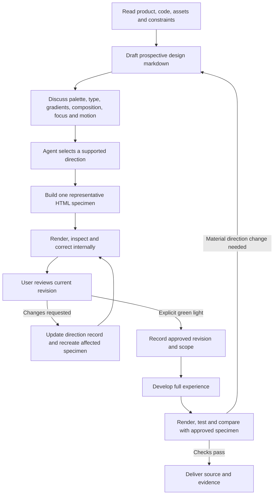

# Prospective direction, specimen, then development

For a full new surface or visual overhaul, collaborate on a concrete direction before full development. A sufficient brief starts research and prototyping immediately. It does not by itself approve the agent's visual interpretation. Local fixes inherit an approved identity and need no new style tournament. An explicit instruction to skip review, use an already approved direction, or select and build autonomously can waive this gate; record that instruction rather than asking again.

## Make the prospective file useful

Use `prospective-design.md` for websites or the existing surface brief for UI. Write an agent recommendation with reasons from product evidence. Include actual candidate colors and semantic roles, font families with inspected word samples, gradient use or deliberate absence, focal hierarchy, spacing/density relationships, shapes, icon policy, keyboard focus, imagery, 2D/3D route, motion and static reading behavior. Avoid asking the user to select a named design genre or tune CSS values. Translate preferences into implementation decisions yourself.

Alternatives are a **soft choice in this Markdown file**, not a requirement to produce five pages, five sections or five scores. Offer additional directions only when there is a meaningful uncertainty or the user wants comparison. Start with one recommended specimen. If several are useful, a single HTML viewer can host them; there is no minimum count. Do not quietly reproduce five near-identical layouts to satisfy a removed quota.

## Make a reviewable specimen

Build `design-specimen.html` or `design-specimens.html`, or an equivalent existing preview route. Include the opening composition, a representative later content/task segment, a meaningful primary action/state, responsive behavior and one decisive interaction. Use actual product content and selected fonts/assets; identify provisional assets and unverified claims. A swatch sheet, screenshot mockup, empty viewer or isolated hero cannot establish the whole direction. A 3D specimen must honestly distinguish a working scene from a storyboard/poster, and respect the 3D pipeline's research/MCP gates.

Render and inspect before asking the user to review. Supply a runnable preview or accessible artifact, current revision, representative desktop/phone images, concise reasons for the selection, known limits and the specific decision needed. Do not ask for approval of an unbuilt plan when the user needs to see the design. Follow [visual-review-loop.md](visual-review-loop.md) proportionally; full viewport/state coverage remains required for production acceptance.

## Iterate without losing decisions

Maintain one short ledger in the direction record:

| Revision | User feedback and exact decision | Changes made | Evidence/preview | State |
| --- | --- | --- | --- | --- |

Use draft, awaiting review, changes requested or approved. Summarize accepted choices, unresolved choices and what the current revision changes. Recreate the affected specimen, inspect it, and present that revision again. Preserve accepted work unless feedback changes it. Do not claim approval from silence, a fit score, an automated check, elapsed time, or a general compliment. A request to “make it warmer” is a revision request, not development approval.

**Wait for explicit user green light on the current direction before full development**, unless they already explicitly waived this review. Record the approval message, revision and authorized scope. Approval covers the represented direction; it does not authorize publishing, changing accounts or unrelated work. While review is pending, continue bounded independent research and prototype fixes, not the full implementation hidden behind a “prototype” label.

After approval, use the specimen as an acceptance baseline. Routine responsive/accessibility fixes do not require repeated approvals. A material change to palette identity, type identity, information architecture, primary interaction or spatial concept goes back to the user with an updated specimen before that change drives development. User approval does not excuse false claims, broken controls or accessibility failures.
