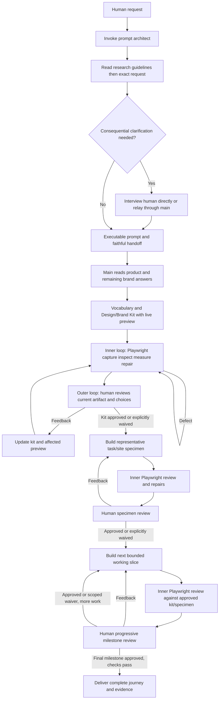

# Two nested reviews for progressive development

For a new surface/overhaul, review the brand kit, consequential design choices, representative specimen and meaningful working milestones. Existing approvals and explicit scoped waivers persist. A local fix inherits identity and uses proportional review; do not restart branding for a control correction.

## Plan review boundaries

After discovery, record a small project-specific milestone plan in `human_reviews`: kit, specimen, consequential choices and meaningful slices (for example the primary task with recovery, then the complete journey). Milestones should expose real decisions and coherent functionality, not every token or commit. No fixed number of directions/pages or unnecessary approval ceremony. General permission to build is not approval of an unseen brand interpretation. An explicit instruction to choose/build autonomously can waive named reviews; record its actual scope instead of asking again. A specimen-only waiver does not silently waive kit or later milestone reviews.

## Inner loop: agent and Playwright

For each reviewable artifact, render the current revision, capture applicable desktop/phone and risk states, open every image, exercise its important interaction, measure actual pairs and repair ranked defects at source. Recapture the affected states and compare with the approved kit/specimen. Full production acceptance uses [visual-review-loop.md](visual-review-loop.md), including short laptop, tablet, 320px, reduced motion and zoom/DPR checks. An unopened capture, green script or attractive static image is not evidence of a working interaction. If a browser is unavailable, report that exact gap and partial verification; do not claim the inner review passed.

## Outer loop: human and agent

Present a runnable preview or accessible artifact, revision, representative images, concise reasons for the choices, changes since the previous review and known limits. Ask for feedback on concrete decisions, not an unbuilt promise or a genre label. For the kit show real product words, semantic colors, component geometry/states, spacing and the relevant illustrative/motion route. A kit preview supports brand decisions; a later specimen must show the actual decisive relationship, representative later segment, primary action and failure/recovery.

Record feedback exactly, interpret it as implementation rules, update the canonical kit and repeat the inner loop before showing the next revision. Explicit green light or a recorded scoped waiver is required before work dependent on that boundary. While pending, continue independent discovery, technical probes and corrections without silently building the rest. A compliment, silence, elapsed time or fit score is not approval. One approval covers its described revision/scope, not external publication or unrelated work.

| Milestone/artifact | Revision | Inner evidence and repairs | Human feedback/exact decision | Status/scope | Next dependent slice |
| --- | --- | --- | --- | --- | --- |

Keep this ledger in the existing direction document/contract, not a second approval system. Use `pending`, `changes-requested`, `approved`, `waived` or `inherited` (local fixes only). If a revised artifact changes an approved material choice, obtain review of that revised choice. Routine accessibility/responsive fixes inside approved rules need no new brand approval. Human requests to revise a milestone authorize those revisions and their retests, not unrelated dependent slices.

## Hold the kit across development

Before each slice compare its type, palette, geometry, spacing, illustrations, state behavior and motion with the approved kit. Reject identity drift outside the hero or main success state. Dynamic geometry remains available: pills, square edges, rounded containers and other shapes are tools selected for this product, never global requirements. Material changes to identity, architecture, primary interaction or dimension return to kit/specimen review. Human approval never certifies accessibility, truthful claims, performance or functionality; finish only when their checks also pass.

## Current boundaries and revision history

Keep one canonical `human_reviews` row per boundary, with a stable id. When feedback changes it, append the prior revision, decision and evidence to that row's `history`, then update its current revision/artifact/status. Do not leave a rejected old revision as a separate active boundary after its replacement is approved. History preserves the human exchange; it is not another pending gate.

Set `progression.next_slice` to the intended slice and `progression.depends_on` to the review ids that must approve it. Before dependent work run the execute gate; it rejects a pending or changes-requested dependency while allowing future reviews to remain pending. Independent research/corrections may continue. Update dependencies at every milestone rather than marking future slices approved in advance. Existing specimen approval remains separately required by the execute gate. For final delivery, the last planned milestone row must represent the complete journey at `record.revision`; retest and present revised work, or record an applicable explicit autonomous-development waiver for that scope. A stale earlier green light cannot approve a changed final build.
