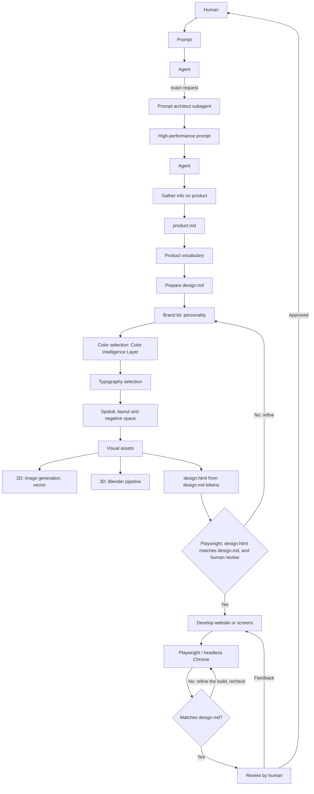

# The design flow and its two review loops

New surfaces and overhauls follow this flow exactly. Every diamond is a gate with an inner Playwright check and, where marked, an outer human decision. "No" always returns to refinement; nothing skips forward. A local fix inherits product.md and design.md, starts at Build, and checks only what it touches.

Components, UX/IA, responsive, motion, accessibility and conversion are written into design.md after visual assets and before design.html; they are omitted from the diagram for readability, not skipped.

## Gate 1: design review (design.html)

**Inner loop (agent + Playwright).** Before showing a human:

1. `node scripts/check-design-sync.mjs --design design.md --url design.html --out <dir>/sync-design.json` passes: every token, declared font and noise budget matches.
2. `node scripts/capture.mjs --url design.html --out <dir>` at desktop and phone, plus `--reduced-motion`. Open every image and write one line per image on what it showed.
3. Measured contrast pairs pass (`node scripts/check-contrast.mjs --pairs <file>`).
4. Repair defects at their source (design.md decision → token → design.html) and re-run.

Record the evidence in `design.inner_review` at the current `design.revision`. Then `--gate design` must exit 0.

**Outer loop (human + agent).** Present design.html, the revision, the opened captures, a short rationale per discipline (why this color, this type, this space) and known limits. Ask for decisions on concrete choices, not on an unbuilt promise or a genre label.

- **No / changes requested**: record the exact words, update the affected design.md sections, then tokens, then design.html; repeat the inner loop; present the new revision. Move the previous decision into the review row's `history`.
- **Yes**: record the exact words, revision and scope in the `design` review row. `--gate build` now exits 0.

## Gate 2: built product matches design.md

After each meaningful slice and before every human milestone review:

1. `node scripts/check-design-sync.mjs --design design.md --url <built page> --out <dir>/sync-site.json` passes against the built product.
2. Full [visual-review-loop.md](visual-review-loop.md): desktop, short laptop, tablet, phone, 320px, reduced motion; open every image; exercise the real task, failure and recovery; measure pairs.
3. A mismatch means the build drifted from the approved system: fix the build, never edit design.md to match the drift. If the design itself must change, that is a material change and returns to Gate 1.

Record `verification.revision` and `verification.sync_report` for the current build revision.

## Gate 3: human review of the working product

Present the complete journey or task at the current revision with its evidence. Feedback returns to Build. Approval of the final milestone at `record.revision` allows delivery; `--gate deliver` checks it.

## Review rules

- Plan review rows in `human_reviews` after PRODUCT: the `design` review, any consequential `design-choice` reviews, and meaningful `milestone` slices (for example the primary action with recovery, then the complete journey). No ceremony for every token or commit.
- A compliment, silence, elapsed time, a fit score or a passing script is not approval. An approval covers its stated revision and scope only.
- An explicit instruction to proceed autonomously can waive named reviews; record its exact words and scope. A design-review waiver does not waive later milestone reviews.
- While a review is pending, continue independent research and fixes; do not build the dependent slice. `progression.depends_on` records which reviews gate the next slice.
- Human approval never certifies accessibility, truthful claims, performance or functionality. If a measured failure appears in an approved choice, fix it with the smallest visual change and explain it.
- Keep one canonical row per boundary with a stable id; append superseded revisions and decisions to its `history`.
