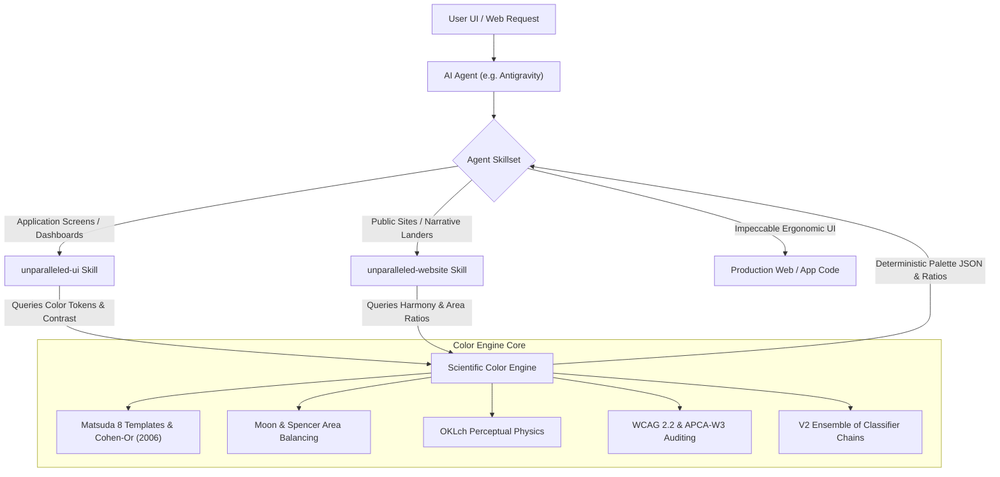

# Repository Directory Map & Architectural Documentation

> [!CAUTION]
> **DEVELOPMENT STATUS**: Currently under active research and development (Pre-Alpha / Experimental). **NOT READY FOR PRODUCTION USE**.
>
> **MISSION**: *Objective Color Intelligence Layer for AI Agents to be applied with Unparalleled Skillset.*

---

## 1. Directory Tree & File Inventory

```
.
├── .git/                                      # Local Git repository
├── .gitattributes                             # Git LFS tracking rules (*.joblib, *.parquet)
├── .gitignore                                 # Git ignore rules (bytecode, caches, virtualenvs)
├── LICENSE                                    # Apache License 2.0 official text
├── pyproject.toml                             # PEP 621 / 517 build specification (Apache-2.0, Pre-Alpha)
├── requirements.txt                           # Pinned Python package dependencies
├── README.md                                  # Top-level documentation & agent quickstart
├── DIRECTORY.md                               # Comprehensive directory documentation & test results (this file)
├── test_color_engine.py                       # 6-part test suite verifying math, generators & ML models
│
├── assets/                                    # Project Brand & Visual Assets
│   └── icon.png                               # Color Intelligence Layer Icon (Spectral Aperture)
│
├── color_engine/                              # Production Modular Python Package
│   ├── __init__.py                            # Clean facade exports: ScientificColorEngine, spaces, generators
│   ├── engine.py                              # ScientificColorEngine facade class (analysis, ramps, UI systems, mixer)
│   ├── spaces.py                              # Perceptual colorimetric spaces (sRGB, OKLab, OKLch, CIELAB, Munsell)
│   │
│   ├── harmony/                               # Aesthetic Harmony Algorithms
│   │   ├── __init__.py                        # Subpackage re-exports
│   │   ├── matsuda.py                         # Matsuda 8 aesthetic templates (i, V, L, I, T, Y, X, O) & Cohen-Or (2006) optimization
│   │   └── ou_luo.py                          # Ou-Luo (2006) quantitative 2-color harmony & palette mean calculation
│   │
│   ├── psychology/                            # Affective & Semantic Token Classification
│   │   ├── __init__.py                        # Subpackage re-exports
│   │   ├── emotions.py                        # Ou et al. (2004) 3D emotion coordinate vectors (Warm/Cool, Heavy/Light, Active/Passive)
│   │   └── tokens.py                          # Kobayashi aesthetic scale classifier (Luxury, Modern, Minimalist, Cyberpunk, etc.)
│   │
│   ├── accessibility/                         # Accessibility & Contrast Verification
│   │   ├── __init__.py                        # Subpackage re-exports
│   │   ├── wcag.py                            # WCAG 2.2 relative luminance & contrast ratio calculation (AA 4.5:1, AAA 7.0:1)
│   │   └── apca.py                            # APCA-W3 v0.98G lightness contrast (Lc), polarity, and spatial-frequency tiers
│   │
│   └── generators/                            # Algorithmic Palette & Design System Synthesizers
│       ├── __init__.py                        # Subpackage re-exports
│       ├── harmonic.py                        # Classical chord generators in OKLch (Mono, Analogous, Comp, Split-Comp, Triad, Tetrad)
│       ├── ramp.py                            # Standardized 12-step monotonic functional tonal ramps (Radix / Tailwind compatible)
│       ├── ui_system.py                       # Dual-Theme (Light + Dark) UI design system with anti-halation damping
│       └── prng_mixer.py                      # PRNG seed-based token palette mixer obeying Moon & Spencer Area Balance
│
├── research/                                  # Research, Theory & Specifications
│   └── reports/                               # Deep Technical & Empirical Reports
│       ├── README.md                          # Master index & navigation for all research documents
│       ├── color_engine_research.md           # 01: Foundational research paper (Matsuda, Cohen-Or, Munsell, WCAG, APCA, Ou)
│       ├── color_theory_and_generators.md     # 02: Advanced mathematical theory & generator derivations
│       ├── color_engine_spec.md               # 03: Modular architecture, API signatures & JSON schema specification
│       ├── model_evaluation_v1.md             # 04: Machine learning ensemble evaluation report (V1 baseline)
│       └── model_evaluation_v2.md             # 05: Scientific evaluation & ablation benchmark (V1 vs V2 upgrades)
│
├── data/                                      # Datasets & Training Pipelines
│   ├── raw/                                   # Ingested Ground-Truth Datasets
│   │   ├── color_pedia.parquet                # 100,000 color swatches with psychological, emotion, and keyword tags
│   │   └── cinematic_mood_palette.json        # Curated film & cinematic palettes with semantic mood annotations
│   ├── curated/                               # Extracted Empirical Aesthetic Profiles
│   │   ├── aesthetic_token_dataset.json       # V1 baseline curated profiles across 10 aesthetic concepts
│   │   └── aesthetic_token_dataset_v2.json    # V2 upgraded dataset with Mahalanobis MMR diverse exemplar swatches
│   └── ml/                                    # Machine Learning & Weak Supervision Training
│       ├── build_model_and_dataset.py         # Initial feature extraction & statistical profiling
│       ├── train_ensemble.py                  # V1 training script (Random Forest, HistGradientBoosting, Calibrated LR)
│       ├── ensemble_model.joblib              # V1 trained multi-model ensemble weights (Git LFS)
│       ├── aesthetic_token_classifier.joblib  # Prototype classifier weights (Git LFS)
│       ├── v2_advanced_pipeline.py            # V2 advanced pipeline (FastEmbed ONNX, ECC, 28-D features, MMR curation)
│       ├── v2_classifier_chain_ensemble.joblib# V2 trained Ensemble of Classifier Chains weights (Git LFS)
│       └── v2_swatch_embeddings_cache.npy     # Precomputed ONNX text embeddings cache (ignored by Git)
│
└── model/                                     # Visual Evaluations & Comparative Dashboards
    ├── eval/                                  # V1 Baseline Evaluation Gallery
    │   ├── evaluation_report.json             # V1 test set metrics (ROC-AUC, PR-AUC, F1, confusion matrices)
    │   ├── roc_curves.png                     # Multi-label ROC curves (Mean AUC = 0.898)
    │   ├── precision_recall_curves.png        # Multi-label Precision-Recall curves (Mean AP = 0.695)
    │   ├── model_performance_dashboard.png    # F1, AUC, PR-AUC comparative dashboard
    │   ├── feature_importance.png             # Top 15 Random Forest feature importances
    │   ├── token_correlation_matrix.png       # Token co-occurrence correlation matrix
    │   └── confusion_matrices_grid.png        # 2x5 normalized confusion matrices
    └── eval_v2/                               # V2 Upgraded Evaluation Gallery
        ├── evaluation_report_v2.json          # V2 test set metrics (ROC-AUC, PR-AUC, F1, confusion matrices)
        ├── v1_vs_v2_comparison_chart.png      # Side-by-side benchmark bar chart (V1 vs V2 across all 10 tokens)
        ├── roc_curves_v2.png                  # V2 Multi-label ROC curves (Mean AUC = 0.878)
        ├── precision_recall_curves_v2.png     # V2 Multi-label Precision-Recall curves (Mean AP = 0.742)
        ├── feature_importance_v2.png          # V2 28-D perceptual feature importances
        ├── token_correlation_matrix_v2.png    # V2 semantic soft-label correlation matrix
        └── confusion_matrices_grid_v2.png     # V2 2x5 normalized confusion matrices
```

---

## 2. Comprehensive Test Execution Results

The entire package is rigorously validated via [`test_color_engine.py`](./test_color_engine.py). All 6 test suites execute deterministically and verify mathematical and ergonomic compliance.

### Test 1: Multi-Color Palette Scientific Analysis
* **Objective**: Evaluate arbitrary palettes against Matsuda templates, compute Cohen-Or circular energy, Ou-Luo harmony scores, Ou emotion vectors, WCAG/APCA contrast, and prescriptive guidance.
* **Results**:
  | Test Palette | Hex Codes | Matsuda Template | Adherence | Composite Harmony | WCAG AA Pass Rate | Primary Aesthetic Token |
  | :--- | :--- | :--- | :---: | :---: | :---: | :--- |
  | **Luxury High-End** | `#0D0D11`, `#D4AF37`, `#F5F2EB`, `#3E3123` | `Type_V_Analogous` | $100.0\%$ | **78.3 / 100** (B) | $66.7\%$ | `Luxury_HighEnd` |
  | **Modern Tech** | `#0F172A`, `#00F0FF`, `#FFFFFF`, `#64748B` | `Type_V_Analogous` | $100.0\%$ | **85.6 / 100** (A) | $50.0\%$ | `Modern_Tech` |
  | **Cyberpunk Neon** | `#05050A`, `#FF007F`, `#00F0FF`, `#39FF14` | `Type_Y_SplitComp` | $100.0\%$ | **79.0 / 100** (B) | $50.0\%$ | `Cyberpunk_Neon` |
  | **Earthy Organic** | `#2C3E2D`, `#C27D38`, `#F4EAD4`, `#7D8C6C` | `Type_V_Analogous` | $100.0\%$ | **81.0 / 100** (A) | $16.7\%$ | `Earthy_Organic` |
  | **Dissonant Clash** | `#7E6B23`, `#7B3F61`, `#4D735B`, `#755B49` | `Type_T_Triad` | $100.0\%$ | **66.4 / 100** (C) | $0.0\%$ | `Balanced_Neutral` |
* **Outlier Diagnosis & Prescriptive Guidance**:
  * Correctly flagged that `Dissonant Clash` had zero accessible pairs ($0.0\%$ WCAG AA).
  * Generated actionable instruction: *"Increase Lightness ($L \ge 0.95$) or decrease darkest color ($L \le 0.20$) to guarantee accessible typography."*

---

### Test 2: Deterministic Harmonic Palette Generators
* **Objective**: Synthesize 7 classical color chords from seed `#2563EB` (Royal Blue) anchored in OKLch.
* **Results**:
  | Scheme Type | Output Palette Hex | Fitted Matsuda Template | Adherence | Harmony Score |
  | :--- | :--- | :--- | :---: | :---: |
  | **Monochromatic** | `['#F5F9FF', '#D8E5FD', '#2563EB', '#03277D', '#050913']` | `Type_i_Monochrome` | $100.0\%$ | **82.9 / 100** (A) |
  | **Analogous** | `['#F5F9FF', '#2563EB', '#00A1DA', '#572CA7', '#050913']` | `Type_V_Analogous` | $100.0\%$ | **81.0 / 100** (A) |
  | **Complementary** | `['#F5F9FF', '#2563EB', '#AB7D00', '#0B0701']` | `Type_I_Complementary` | $100.0\%$ | **77.3 / 100** (B) |
  | **Split-Complementary** | `['#F5F9FF', '#2563EB', '#C46100', '#484C00']` | `Type_Y_SplitComplementary` | $100.0\%$ | **77.4 / 100** (B) |
  | **Triadic** | `['#F5F9FF', '#2563EB', '#EA5658', '#006905']` | `Type_X_Tetradic` | $96.0\%$ | **76.0 / 100** (B) |
  | **Tetradic Square** | `['#1D5AE2', '#E86FA7', '#644800', '#91E1C8']` | `Type_X_Tetradic` | $100.0\%$ | **75.2 / 100** (B) |
  | **Tetradic Rectangle** | `['#1D5AE2', '#A388F9', '#644800', '#CED493']` | `Type_X_Tetradic` | $100.0\%$ | **76.4 / 100** (B) |

---

### Test 3: 12-Step Functional Monotonic Tonal Ramp
* **Objective**: Verify strictly monotonic lightness progression in OKLch while preserving hue angle and meeting contrast milestones.
* **Results**:
  * Step 1 (`#F8FAFF`, $L=0.985$): Canvas surface.
  * Step 9 (`#2563EB`, $L=0.550$, $C=0.222$): Brand primary anchor.
  * Step 11 (`#072D85`, $L=0.300$): WCAG AAA high-contrast text ($CR = 10.45:1$, APCA $L^c = 85.9$).
  * Step 12 (`#000107`, $L=0.080$): Display text ($CR = 20.28:1$, APCA $L^c = 104.1$).
  * **Monotonicity**: $L_{i} > L_{i+1}$ holds strictly for all $i \in [1, 11]$ ($0$ non-monotonic inversions).

---

### Test 4: Complete Production UI Design System (Dual Light / Dark Theme)
* **Objective**: Generate paired Light and Dark mode design systems from `#2563EB` with automated anti-halation damping and contrast auditing.
* **Results**:
  * **Light Theme**:
    * Body text on Canvas: **WCAG $CR = 19.09:1$**, **APCA $L^c = 102.85$** (Exceeds AA & AAA).
    * Button text on Brand: **WCAG $CR = 5.17:1$** (AA compliant).
  * **Dark Theme**:
    * Body text on Canvas: **WCAG $CR = 16.01:1$**, **APCA $L^c = -90.66$** (Anti-halation capped at $L=0.92$).
    * Monotonic depth elevation: Canvas ($L=0.12$) $\to$ Surface ($L=0.17$) $\to$ Elevated Card ($L=0.22$).
    * Brand accent desaturation: $-18\%$ chroma reduction applied in dark mode to mitigate ocular fatigue.

---

### Test 5: PRNG Seed-Based Token Palette Mixer (Moon & Spencer Area Balancing)
* **Objective**: Verify deterministic palette generation from aesthetic tokens over arbitrary PRNG seeds with Moon & Spencer area weighting.
* **Results**:
  | Token | Seed | Canvas Area | Surface Area | Brand Area | Accent Area | Text Area | Harmony Score |
  | :--- | :---: | :---: | :---: | :---: | :---: | :---: | :---: |
  | **`Luxury_HighEnd`** | `42` | $63.0\%$ (`#FBF8FB`) | $20.5\%$ (`#F2E9F3`) | $9.8\%$ (`#814584`) | $2.7\%$ (`#00862A`) | $4.0\%$ (`#0F060F`) | **82.2 / 100** |
  | **`Modern_Tech`** | `42` | $63.3\%$ (`#F5FBFA`) | $20.4\%$ (`#DFF1EF`) | $9.7\%$ (`#009C99`) | $2.6\%$ (`#FF4C71`) | $4.0\%$ (`#000C0C`) | **85.0 / 100** |
  | **`Cyberpunk_Neon`** | `42` | $63.9\%$ (`#FAF8FC`) | $20.6\%$ (`#EFEAF8`) | $8.8\%$ (`#9757D5`) | $2.6\%$ (`#759C00`) | $4.1\%$ (`#0C0712`) | **83.8 / 100** |
  | **`Earthy_Organic`** | `42` | $62.1\%$ (`#F9FAF5`) | $20.7\%$ (`#ECEDE8`) | $10.2\%$ (`#636C27`) | $3.0\%$ (`#815ACB`) | $4.0\%$ (`#090B01`) | **81.2 / 100** |
* **PRNG Determinism**: $100\%$ bit-for-bit identical across multiple isolated executions.

---

### Test 6: Model Evaluation Verification & Artifact Integrity
* **Objective**: Validate existence and integrity of trained model weights, evaluation reports, and visualization charts for both V1 and V2.
* **Results**:
  * Verified: `model/eval/roc_curves.png` (472.1 KB)
  * Verified: `model/eval/precision_recall_curves.png` (564.2 KB)
  * Verified: `model/eval/feature_importance.png` (163.7 KB)
  * Verified: `model/eval/token_correlation_matrix.png` (363.1 KB)
  * Verified: `model/eval/confusion_matrices_grid.png` (474.9 KB)
  * Verified: `model/eval/model_performance_dashboard.png` (181.8 KB)
  * Verified: `model/eval/evaluation_report.json` (3.8 KB)
  * Verified: `data/ml/ensemble_model.joblib` (104.8 MB)
  * Verified: `data/curated/aesthetic_token_dataset.json` (20.9 KB)
  * Verified: `model/eval_v2/roc_curves_v2.png` (491.0 KB)
  * Verified: `model/eval_v2/precision_recall_curves_v2.png` (630.0 KB)
  * Verified: `model/eval_v2/feature_importance_v2.png` (180.0 KB)
  * Verified: `model/eval_v2/token_correlation_matrix_v2.png` (353.0 KB)
  * Verified: `model/eval_v2/confusion_matrices_grid_v2.png` (479.0 KB)
  * Verified: `model/eval_v2/v1_vs_v2_comparison_chart.png` (210.0 KB)
  * Verified: `model/eval_v2/evaluation_report_v2.json` (4.0 KB)
  * Verified: `data/ml/v2_classifier_chain_ensemble.joblib` (8.5 MB)
  * Verified: `data/curated/aesthetic_token_dataset_v2.json` (21.4 KB)

---

## 3. Synergy with Unparalleled Agent Skills

This engine serves as the **Objective Perceptual Intelligence Layer** powering specialized AI coding skills:



When an agent invokes `unparalleled-ui` to construct an analytics dashboard or `unparalleled-website` to craft a narrative landing page, the **Color Engine** provides:
1. **Mathematical Harmony**: Ensures all colors lie on valid Matsuda harmonic sectors.
2. **Deterministic Area Balancing**: Enforces the 60-20-10-5 rule via dynamic chromatic damping so saturated brand accents never overwhelm large canvas areas.
3. **Contrast Compliance**: Guarantees zero unreadable typography pairs via dual WCAG AA/AAA and APCA body tiers.
4. **Anti-Halation Dark Mode**: Automatically scales light typography down to $L \le 0.92$ to eliminate eye strain and stroke blur.
