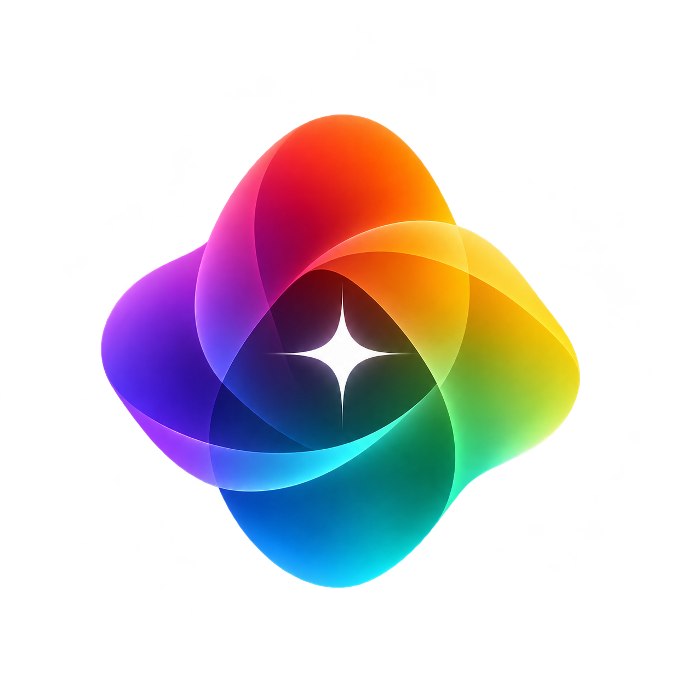
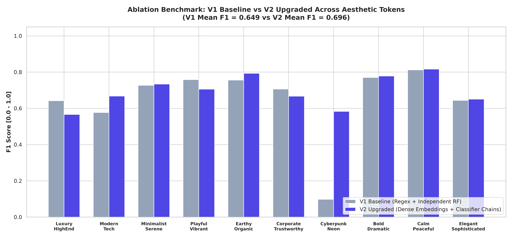

<div align="center">
  
  <h1>Color Intelligence Layer</h1>
  <p><strong>Color analysis and palette generation for AI design agents.</strong></p>

  <p>
    <a href="./LICENSE"></a>
    <a href="./DIRECTORY.md"></a>
    <a href="https://bottosson.github.io/posts/oklab/"></a>
    <a href="https://www.w3.org/WAI/WCAG22/quickref/"></a>
    <a href="https://www.python.org/downloads/"></a>
  </p>
</div>

> [!CAUTION]
> **Pre-alpha — not ready for use.** This project is under active research and development. APIs, data schemas, and model weights may change without notice.

## Overview

Color Intelligence Layer is a Python library for evaluating palettes and generating color tokens for websites, applications, and design systems. It combines perceptual color models, harmony scoring, contrast calculations, and machine learning research to give AI agents structured feedback on color choices.

The engine reports foreground/background contrast, identifies hue outliers, suggests palette adjustments, and generates coordinated light and dark themes. It is intended to support the `unparalleled-ui` and `unparalleled-website` agent skills.

Harmony scores and aesthetic labels reflect the models and datasets used by the project. They support design decisions; they do not establish a universal measure of visual quality.

## Capabilities

| Capability | Description |
| :--- | :--- |
| Palette analysis | Combines Matsuda's eight hue templates, Cohen-Or-style template optimization, and Ou-Luo pairwise harmony calculations into a composite score from 0 to 100. Identifies hue outliers and returns suggested adjustments. |
| Contrast checks | Reports WCAG contrast ratios and APCA-W3 v0.98G lightness contrast, including polarity and readability tiers. |
| Perceptual color calculations | Uses OKLab and OKLch for palette generation and color differences, with CIELAB and Munsell representations for additional analysis. |
| Theme generation | Creates light and dark theme tokens for surfaces, borders, typography, actions, and status colors from a brand seed. Includes contrast results for selected text/background pairs. |
| Dark theme controls | Sets primary text lightness to 0.92 in OKLch and uses increasing surface lightness values of 0.12, 0.17, and 0.22 to establish depth. |
| Seeded palette generation | Produces repeatable palettes from aesthetic tokens such as `Luxury_HighEnd`, `Modern_Tech`, and `Cyberpunk_Neon`, using an integer or string seed. Returns suggested area proportions based on role weights and chroma. |
| Tonal ramps | Generates 12-step ramps with monotonic lightness for use as design tokens. |

## Usage examples

The examples below use the `ScientificColorEngine` interface. Run them from a checkout with the project's dependencies installed.

### Analyze a palette

```python
from color_engine import ScientificColorEngine

engine = ScientificColorEngine()
analysis = engine.analyze_palette(["#0D0D11", "#D4AF37", "#F5F2EB", "#3E3123"])
summary = analysis["summary"]

print(f"Harmony score: {summary['composite_harmony_score']}/100")
print(f"Harmony grade: {summary['harmony_grade']}")
print(f"Best template: {summary['best_matsuda_scheme']['template']}")
print(f"Primary token: {summary['primary_aesthetic_token']}")
print("Suggested adjustments:", analysis["actionable_guidance_for_ai"])
```

### Generate light and dark themes

```python
ui = engine.generate_ui_design_system(seed_hex="#2563EB")
light = ui["light_theme"]
dark = ui["dark_theme"]

print("Light canvas:", light["surfaces"]["canvas"])
print("Dark canvas:", dark["surfaces"]["canvas"])
print(
    "Light theme body contrast:",
    light["accessibility_verification"]["body_text_on_canvas"]["wcag_cr"],
)
```

### Generate a palette from an aesthetic token

```python
mix = engine.mix_palette_by_token(
    token="Cyberpunk_Neon",
    seed="fintech-neon-2026",
    palette_size=5,
    version="v2",
)

for item in mix["palette_mix"]:
    print(f"{item['role']}: {item['hex']} ({item['area_mixing_percentage']} of visual area)")
```

## Model evaluation

The repository includes two generations of aesthetic classification models developed using a dataset of 100,000 color swatches. The table below reproduces the stored V1 and V2 evaluation results. Changes are relative to V1; thresholds are reported for V2.



| Aesthetic Token | V1 PR-AUC | V2 PR-AUC | $\Delta$ PR-AUC | V1 $F_1$ | V2 $F_1$ | $\Delta$ $F_1$ | V2 Threshold |
| :--- | :---: | :---: | :---: | :---: | :---: | :---: | :---: |
| **`Cyberpunk_Neon`** | $0.0523$ | **$0.6114$** | **+1,069.0%** | $0.0978$ | **$0.5833$** | **+496.4%** | $0.26$ |
| **`Modern_Tech`** | $0.6113$ | **$0.6947$** | **+13.6%** | $0.5771$ | **$0.6678$** | **+15.7%** | $0.29$ |
| **`Bold_Dramatic`** | $0.7302$ | **$0.8474$** | **+16.1%** | $0.6865$ | **$0.7781$** | **+13.3%** | $0.36$ |
| **`Calm_Peaceful`** | $0.8120$ | **$0.8818$** | **+8.6%** | $0.7712$ | **$0.8167$** | **+5.9%** | $0.27$ |
| **`Earthy_Organic`** | $0.8430$ | **$0.8804$** | **+4.4%** | $0.7556$ | **$0.7933$** | **+5.0%** | $0.38$ |
| **`Minimalist_Serene`** | $0.7788$ | **$0.7990$** | **+2.6%** | $0.7271$ | **$0.7342$** | **+1.0%** | $0.39$ |
| **`Playful_Vibrant`** | **$0.8221$** | $0.7902$ | -3.9% | **$0.7581$** | $0.7057$ | -6.9% | $0.44$ |
| **`Corporate_Trustworthy`** | **$0.7494$** | $0.7043$ | -6.0% | **$0.7063$** | $0.6667$ | -5.6% | $0.34$ |
| **`Luxury_HighEnd`** | **$0.6803$** | $0.5745$ | -15.5% | **$0.6417$** | $0.5660$ | -11.8% | $0.22$ |
| **`Elegant_Sophisticated`** | $0.6750$ | $0.6391$ | -5.3% | $0.6480$ | **$0.6507$** | **+0.4%** | $0.38$ |
| **Macro Average** | **$0.6954$** | **$0.7423$** | **+6.7%** | **$0.6490$** | **$0.6963$** | **+7.3%** | **$0.33$** |

V2 improves macro-average PR-AUC from 0.6954 to 0.7423 and macro-average F1 from 0.6490 to 0.6963. Results vary by token: `Cyberpunk_Neon` shows the largest improvement, while `Playful_Vibrant`, `Corporate_Trustworthy`, and `Luxury_HighEnd` decline on both metrics.

The V2 pipeline introduces three main changes:

- **Label generation:** Combines text embeddings from `all-MiniLM-L6-v2` with color-based priors through programmatic weak supervision, replacing the V1 keyword-based approach.
- **Classification:** Uses an ensemble of classifier chains to model dependencies between aesthetic labels.
- **Swatch selection:** Uses Mahalanobis distance and maximal marginal relevance to select more varied exemplar swatches.

See the [V1 evaluation](./research/reports/model_evaluation_v1.md) and [V2 evaluation](./research/reports/model_evaluation_v2.md) for methodology, per-token results, and ablation analysis. These benchmarks evaluate the project's aesthetic labels rather than overall design quality or accessibility.

## Agent integration

The intended workflow connects the engine to the Unparalleled skills:

```text
unparalleled-ui / unparalleled-website
    | Request palette analysis, theme tokens, or area proportions
    v
Color Intelligence Layer
    | Return color tokens, scores, contrast results, and suggested adjustments
    v
Agent-generated website or application
```

For application interfaces, agents can use the output to compare text/background pairs and establish surface hierarchies. For websites, they can use palette scores and area proportions to guide accent placement and visual balance.

## Verification

Run the repository's verification script from the project root:

```bash
python3 test_color_engine.py
```

The script covers palette analysis, harmonic palette generation, tonal ramps, light and dark themes, seeded palette mixing, and model artifact integrity.

## Documentation

- [Repository directory map](./DIRECTORY.md)
- [Foundational research and equations](./research/reports/color_engine_research.md)
- [Color theory and palette generation](./research/reports/color_theory_and_generators.md)
- [Architecture and JSON specification](./research/reports/color_engine_spec.md)
- [V1 model evaluation](./research/reports/model_evaluation_v1.md)
- [V2 model evaluation and ablation benchmarks](./research/reports/model_evaluation_v2.md)

## License

Licensed under the Apache License, Version 2.0. See [LICENSE](./LICENSE) for details.
