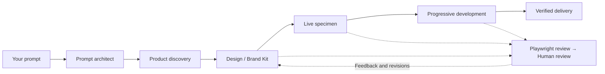

<p align="center">
  
</p>

<h1 align="center">Unparalleled</h1>

<p align="center">Design skills with a point of view.<br>Build with your agent. Review the work together.</p>

<p align="center">
  <a href="CHANGELOG.md"></a>
  <a href="https://nodejs.org/"></a>
  <a href="LICENSE"></a>
  <a href="guides/unparalleled.md"></a>
  <a href="guides/studio.md"></a>
</p>

<p align="center">
  <a href="#start-here">Quick start</a> ·
  <a href="guides/unparalleled.md">Skill manual</a> ·
  <a href="guides/studio.md">Studio manual</a> ·
  <a href="docs/installation.md">Installation</a> ·
  <a href="CHANGELOG.md">Changelog</a>
</p>

---

Unparalleled helps coding agents design websites and working interfaces around the actual product. It connects prompt research, a binding brand kit, authored assets, implementation and rendered review. You review the brand and consequential choices as the work develops.

**Unparalleled Studio** brings the conversation onto your running page: pick an element, describe a change, let your existing agent edit the source, then keep or undo the result.

## Start here

Requires **Node.js 20+**, npm and a supported coding agent. Run these commands inside your project. Downloads use this GitHub repository.

```bash
npx github:Phantom-Con-Artist/unparalleled-skillset setup
npx github:Phantom-Con-Artist/unparalleled-skillset doctor
```

Start a new agent session after installation. Ask for the applicable skill:

> Use unparalleled-website to build our botanical research website. Start with the prompt architect, understand the product, and review the brand kit with me before the specimen. Develop progressively with Playwright checks and human review.

For an application, use `unparalleled-ui`. You can name the skill in plain language or use your agent's skill picker.

<details>
<summary><strong>Install one skill, choose an agent, or update</strong></summary>

```bash
# Choose the surface
npx github:Phantom-Con-Artist/unparalleled-skillset install website
npx github:Phantom-Con-Artist/unparalleled-skillset install ui

# Choose integrations or preview the installation
npx github:Phantom-Con-Artist/unparalleled-skillset install all --agent claude,codex
npx github:Phantom-Con-Artist/unparalleled-skillset install all --dry-run

# Install across projects, or refresh an existing installation
npx github:Phantom-Con-Artist/unparalleled-skillset install all --global
npx github:Phantom-Con-Artist/unparalleled-skillset update
```

The installer copies skills and adds managed routing notes. It preserves unrelated project instructions and backs up overwritten content. It does not change agent credentials, trust or permissions. The optional Claude Code hook changes project settings only when explicitly requested with `hook --write`.

[Installation, options and recovery →](docs/installation.md)

</details>

## Two skills, one design discipline

| | Unparalleled Website | Unparalleled UI |
| --- | --- | --- |
| **Use for** | Public websites, portfolios, landing pages and product stories | Applications, dashboards, tables, editors, forms and settings |
| **Design around** | The offer, a product-specific demonstration and the visitor's journey | The actual task, data relationships, decisions and recovery |
| **Production** | 2D, 3D or hybrid; illustration, meaningful motion and kinetic text when useful | Product-derived components, readable density, keyboard/touch use and complete states |
| **Read the skill** | [unparalleled-website](.agents/skills/unparalleled-website/SKILL.md) | [unparalleled-ui](.agents/skills/unparalleled-ui/SKILL.md) |

Each skill is independently installable and includes its own references, templates and tools. The agent recommends a stack from the project context; your explicit choices take precedence.

## From your prompt to a working experience



The prompt architect reads the bundled research guidelines, clarifies consequential gaps and hands a faithful executable prompt to the main agent. The main agent then creates the **Design/Brand Kit**: vocabulary, philosophy, fonts, semantic color, component geometry, spacing, backgrounds, assets, UX and production pipelines.

Two reviews work together. The **inner loop** renders, inspects, measures and repairs with Playwright. The **outer loop** brings the current kit, design choices, specimen and working milestones to you. Approvals and feedback stay in the design record. Local fixes inherit established choices; explicit scoped review waivers are respected.

Shapes are chosen dynamically. Pills, rounded components, square edges and other forms are available when they fit the product and task. Palette scores and type ratios help compare decisions; actual accessibility and rendered behavior remain separate checks.

[How to brief, review and resume work →](guides/unparalleled.md)

## Unparalleled Studio


*Studio's included practice page. The Activity panel shows a source change ready for review.*

```bash
# Try the included practice page
npx github:Phantom-Con-Artist/unparalleled-skillset studio --demo --port 4310

# Or attach Studio while serving a static project
npx github:Phantom-Con-Artist/unparalleled-skillset studio --root ./my-site --port 4310
```

Open the printed URL. Copy the printed instruction to your coding agent, keep it listening, then use **Pick** for an element or **Page** for a broader instruction. Review the result in **Activity** and choose **Keep edit** or **Undo source edit**.

Studio includes computed-style inspection, source-location hints, a durable request queue, guarded source edits, multi-file transactions, reference picking and an MCP server. It uses your existing agent; the browser overlay does not run a model or automatically wake an ended conversation.

Use the development-only Vite adapter for Vite projects. Static serving does not compile framework source. [The Studio manual](guides/studio.md) covers setup, the agent loop, Vite, MCP, references, patch files and troubleshooting.

## Works with your agent

The installer supports **Codex, Claude Code, Cursor, GitHub Copilot, Gemini CLI, Antigravity, Windsurf, Devin, OpenCode, Cline, Roo Code and Kiro**. Detection finds local executables/configuration; it does not prove an agent is logged in or that every integration offers identical capabilities.

A browser is needed for rendered review. Blender/MCP, image generation and motion renderers are used when the chosen pipeline needs them. They are not silently installed with the skills. If delegation or another capability is unavailable, the agent reports the limit instead of fabricating evidence.

## Manuals and references

| Guide | What you will find |
| --- | --- |
| [Unparalleled manual](guides/unparalleled.md) | Installation, useful prompts, brand-kit review, progressive work, local fixes and validation tools |
| [Studio manual](guides/studio.md) | Page picking, agent connection, Vite, MCP, source patches, references and recovery |
| [Installation reference](docs/installation.md) | Command options, discovery paths, updates, backups and optional prompt hook |
| [Design measurements](.agents/skills/unparalleled-website/references/design-measurements.md) | Color diagnostics, type scales, layout, motion and performance criteria |
| [Changelog](CHANGELOG.md) | What changed in 1.2.0 |

## Development

```bash
git clone https://github.com/Phantom-Con-Artist/unparalleled-skillset.git
cd unparalleled-skillset
npm install
npm test
npm run validate-all
npm run check-contrast
```

`validate-all` checks skill structure and local links. `check-contrast` without input checks reference fixtures. Neither certifies a generated interface; inspect the render and measure its actual foreground/background pairs.

The repository contains the installer (`bin/`, `lib/`), standalone skills (`.agents/skills/`), Studio packages (`packages/`), runnable examples (`examples/`) and the public showcase (`site/`). Legacy unused layout fragments and retired catalog stubs have been removed; the examples remain illustrative, not universal design presets.

[MIT License](LICENSE) · Created by [Subhradeep Sarkar](https://github.com/Phantom-Con-Artist)
