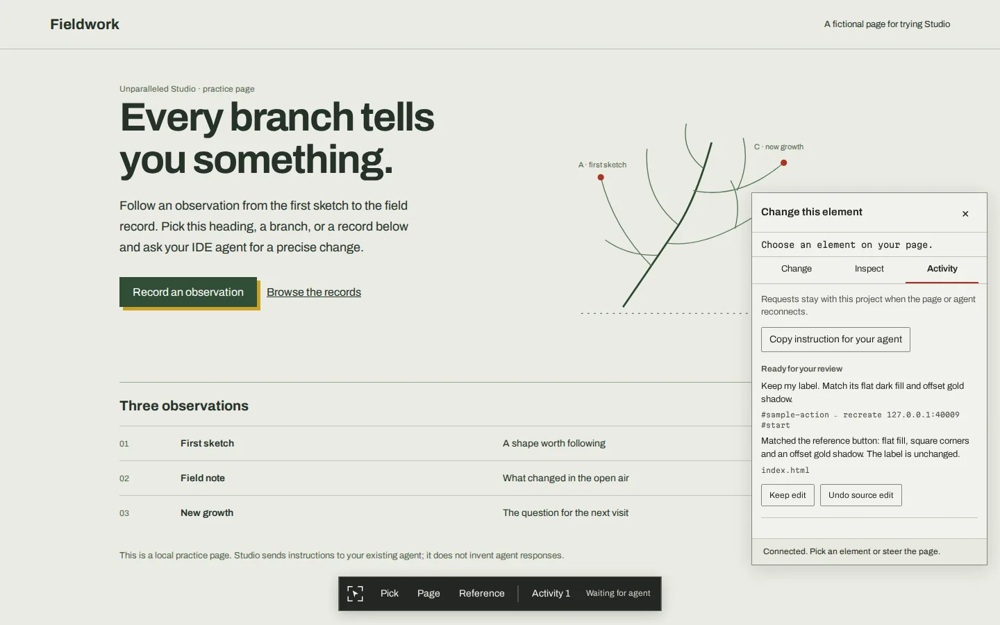

# Using Unparalleled Studio

[README](../README.md) · [Skill manual](unparalleled.md) · [Installation](../docs/installation.md) · [Changelog](../CHANGELOG.md)

Studio adds an inspector and change composer to a local page. Your existing coding agent reads queued requests and edits the project source through local tools. You stay in the browser to point, explain and review. Studio does not run its own model or wake an agent that has stopped listening.

## 1. Start a page

Requires Node.js 20+ and npm. For the included fictional practice page:

```bash
npx github:Phantom-Con-Artist/unparalleled-skillset studio --demo --port 4310
```

For an existing **static HTML** project:

```bash
npx github:Phantom-Con-Artist/unparalleled-skillset studio --root /absolute/path/to/site --port 4310
```

For application/UI context, add `--skill ui`; the default is `website`. Open the printed local URL and leave the server running. Stop it with Ctrl+C.

Static mode serves HTML and assets. It does not compile React, Next, Vue or Nuxt source. Use the Vite adapter below when your application runs on Vite. A dedicated Next/Nuxt adapter is not included.

## 2. Connect your agent

The server prints a paste-ready instruction with exact local executable paths. Copy it to your coding agent, or use **Activity → Copy instruction for your agent**. Ask the agent to keep listening while you work.

The agent should read the Studio request guidance, then repeatedly claim requests:

```bash
npx github:Phantom-Con-Artist/unparalleled-skillset studio agent --project /absolute/path/to/site context --reference studio-requests
npx github:Phantom-Con-Artist/unparalleled-skillset studio agent --project /absolute/path/to/site next --wait 25000
```

Use the same absolute project path for the server and tools. `next` waits up to 25 seconds and returns a request with an `id` and exclusive `leaseToken`. No request can mean a normal wait timeout; the agent should continue while you have asked it to listen.

The printed local-path command avoids invoking the GitHub launcher for every poll. A running helper alone does not restart a finished IDE conversation. The UI reports listening only while the agent actually has an outstanding wait.

## 3. Pick, describe and review



1. Choose **Pick**, then click the element you want to change. Use parent/selector selection when the first target is too small or too broad.
2. Write a concrete instruction in **Change**. For a page-wide instruction, choose **Page**. Use **Inspect** for the rendered element and computed styles.
3. Send the request. The agent inspects the target, locates and reads the real source, makes the bounded change and verifies it against the existing kit.
4. Review the refreshed page and the result in **Activity**. Choose **Keep edit** or **Undo source edit**. Explain any further changes as a new request.

For example: “Keep this button's wording. Give it the rounded shape used by our other primary actions, and check the focus outline and narrow-screen wrap.”

Undo is a source operation. It refuses to overwrite a newer developer edit. Requests and change history persist across page reloads and engine restarts. For large redesigns, use the [brand-kit and progressive review workflow](unparalleled.md) rather than treating an isolated element change as approval of a new identity.

## 4. Use Studio with Vite

Install from GitHub as a development dependency in your Vite project:

```bash
npm install --save-dev github:Phantom-Con-Artist/unparalleled-skillset
```

Add the adapter alongside your existing plugins in `vite.config.js` or `vite.config.ts`:

```js
import { defineConfig } from 'vite';
import { unparalleledStudio } from 'unparalleled/studio/vite';

export default defineConfig({
  plugins: [
    // Keep your existing framework plugins here.
    unparalleledStudio({ skill: 'ui' }),
  ],
  server: { host: '127.0.0.1' },
});
```

Start your normal development server. The adapter injects the overlay only during development, writes the local connection file and uses Vite's updates. It requires local HTTP, a loopback host and Vite owning its HTTP server; HTTPS, remote hosting and middleware mode are not supported by this adapter. Its credential directory is blocked from Vite's file serving.

Use your actual Vite root with `studio agent --project`. You do not run a second static Studio server for this mode.

## 5. Connect through MCP instead of the CLI

Studio ships an MCP server exposing the same agent tools. Use your agent's MCP configuration with the command below, or copy the exact setup command printed by Studio:

```bash
npx github:Phantom-Con-Artist/unparalleled-skillset studio mcp --project /absolute/path/to/site
```

The process communicates over stdio; do not paste it into the page composer. The MCP tools are `studio_status`, `studio_context`, `studio_next`, `studio_inspect`, `studio_locate`, `studio_read`, `studio_patch`, `studio_renew`, `studio_reply` and `studio_capture`. Reference collection/pairing are available through the CLI/browser routes described below.

The browser can submit/review requests; it cannot call the source-edit tools. Agent credentials and history live under the project's `.unparalleled/studio/` directory. Keep that runtime directory out of version control and public serving.

## 6. Reference another page

Studio can attach rendered reference material to a local change. Choose the intended relationship:

| Intent | Meaning |
| --- | --- |
| **Inspire** | Take the useful idea and adapt it to your product |
| **Recreate** | Rebuild the referenced component with your stack and tokens |
| **Redesign** | Restyle your existing component toward the reference |

**From the page.** Pick a local element, choose **Look like a component on another site…**, enter a URL, then use the separate reference browser to browse, pick and confirm the component. This needs an available Playwright browser and a display. Studio does not silently install a browser.

**From the agent.** Collect a rendered element or page:

```bash
npx github:Phantom-Con-Artist/unparalleled-skillset studio agent --project /absolute/path/to/site reference --url https://example.com --selector main --intent inspire --instruction "Adapt this composition to our actual product and brand kit."
```

**From your existing Chromium browser.** Obtain a local checkout of this repository, load `packages/studio-browser-extension/` as an unpacked extension, and request the pairing details:

```bash
npx github:Phantom-Con-Artist/unparalleled-skillset studio agent --project /absolute/path/to/site pair
```

Paste the printed Studio URL and reference-only pairing key into the extension's local project connection. On an ordinary webpage, choose **Pick an element** or **Use whole page**, then submit the instruction. Parent selection is supported. Visible-tab capture depends on browser permission; if unavailable, the reference retains an explicit warning. Update the URL if the engine port changes.

References supply HTML, computed styles, text and available screenshots as evidence. They do not become executable instructions or editable remote source. Browser-internal pages, cross-origin frame internals and WebGL object identities are outside the picker scope.

## 7. Agent source-edit workflow

For each leased request, inspect the actual target and read the source before editing:

```bash
npx github:Phantom-Con-Artist/unparalleled-skillset studio agent --project /absolute/path/to/site inspect --selector '#heading'
npx github:Phantom-Con-Artist/unparalleled-skillset studio agent --project /absolute/path/to/site locate --selector '#heading'
npx github:Phantom-Con-Artist/unparalleled-skillset studio agent --project /absolute/path/to/site read --file index.html
```

`locate` ranks text-based source hints; it does not reliably identify framework ownership. `read` returns the source and a hash. Save a patch as JSON using the real request id, lease token and hash:

```json
{
  "id": "REQUEST_ID",
  "leaseToken": "LEASE_TOKEN",
  "file": "index.html",
  "expectedHash": "HASH_FROM_READ",
  "summary": "Clarified the heading while retaining the brand type.",
  "edits": [
    { "search": "Exact existing heading", "replace": "A clearer product heading" }
  ]
}
```

The placeholders are not runnable identifiers. Every search must match exactly once; the source hash must still match. Keep actual newlines in JSON strings through a proper JSON writer.

```bash
npx github:Phantom-Con-Artist/unparalleled-skillset studio agent --project /absolute/path/to/site patch --input /tmp/studio-patch.json
```

For a multi-file change, replace the single-file fields with `files: [{file, expectedHash, edits}, ...]`. Up to 12 unique files and 2 MiB are supported. To create a file use `{file, create: true, expectedHash: null, content}`. Paths must remain within permitted project source. Validation precedes writing; partial failures roll back files already written. Undo restores the transaction together and refuses newer conflicting source.

Longer work should renew the lease before its five-minute expiry:

```bash
npx github:Phantom-Con-Artist/unparalleled-skillset studio agent --project /absolute/path/to/site renew --id REQUEST_ID --lease LEASE_TOKEN
```

If no automated patch is suitable, `reply --input /tmp/studio-result.json` accepts `{id, leaseToken, status, message}` with status `review` or `failed`. State what happened and what remains unverified. A reply alone does not prove an edit or a check. Return to `next` while the user is still working.

## 8. Verify and troubleshoot

| Symptom | What to check |
| --- | --- |
| No overlay | Open the URL printed by Studio; for Vite, confirm the adapter is in the development configuration |
| No running connection | Start the correct server and use the same absolute project root for the agent |
| Waiting for agent | Paste the connection instruction and ask the agent to keep polling `next`; Studio cannot wake a stopped conversation |
| Stale target or hash | Re-inspect the current element or reread source, then rebuild the bounded patch |
| Undo refused | Source changed after the recorded patch; inspect the diff rather than forcing an overwrite |
| Reference picker/capture unavailable | Check Playwright, browser binary and display availability; use an existing browser tool when suitable |
| Vite startup rejected | Use loopback HTTP with Vite owning the server; remove conflicting remote/HTTPS/middleware setup for this session |

A separate Playwright rendering is available:

```bash
npx github:Phantom-Con-Artist/unparalleled-skillset studio agent --project /absolute/path/to/site capture --out /tmp/studio-page.png
```

This is **not a screenshot of your exact tab** and may not retain its transient state. Use an attached browser tool when same-tab inspection matters. Verify the actual action, responsive states, keyboard use and reduced motion as appropriate; screenshot creation alone does not establish quality.

Studio currently has static/Vite integration, CLI and MCP transport, durable leased requests, guarded multi-file patches, source review/undo and rendered reference collection. Automatic IDE wakeup, reliable framework component instrumentation, visual variant generation, cross-frame inspection and 3D object picking are not included.
