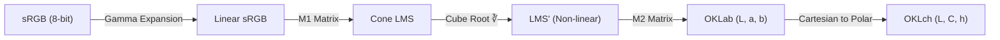
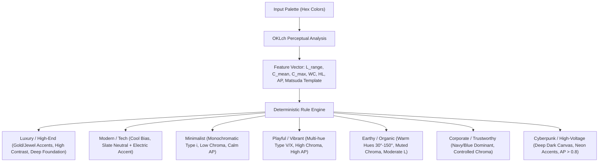

# Scientific Color Engine for AI Agents: Harmonic Scoring, Perceptual Colorimetry, and Deterministic Aesthetic Token Classification

> [!IMPORTANT]
> **Core Premise**: Large Language Models and AI agents have no retinas, visual cortex, or subjective aesthetic taste. They operate on text tokens and abstract hex codes. When tasked with selecting colors, AI agents routinely produce dissonant palettes, unreadable contrast failures, and generic or clashing color schemes. This Color Engine replaces subjective "vibes" with rigorous, psychophysically validated color science, yielding deterministic numerical scores, outlier diagnoses, and concrete semantic tokens.

---

## 1. Mathematical & Colorimetric Foundations

### 1.1 The Pitfalls of Conventional Color Spaces (sRGB, HSV, HSL, CIELAB)

To calculate color harmony and contrast scientifically, the underlying color space must reflect human visual perception. Standard digital color spaces fail this test:

1. **sRGB & HSV/HSL Distortions**:
   * In HSL, pure Yellow (`#FFFF00`) and pure Blue (`#0000FF`) both have Lightness $L = 50\%$ and Saturation $S = 100\%$. However, to the human eye, Yellow has a relative luminance $Y = 0.9278$, whereas Blue has $Y = 0.0722$—over **12 times darker**.
   * Rotating hue in HSL causes severe, uncontrolled swings in perceived brightness and visual weight.
2. **CIELAB (1976) & The Abney Effect**:
   * While CIELAB improved upon sRGB, it suffers from the **Abney effect**: lines of constant perceived hue curve in the blue region ($260^\circ$ to $310^\circ$). As blue desaturates toward white or gray, its hue shifts perceptually into purple/violet ($>20^\circ$ error).
   * Euclidean distance $\Delta E^*_{ab}$ in CIELAB is non-uniform, requiring complex patch formulas like $\Delta E_{00}$ (CIEDE2000).

### 1.2 OKLab & OKLch (Björn Ottosson, 2020)

**OKLab** is an opponent-color space explicitly trained on CAM16-UCS lightness and chroma data alongside the Hung & Berns (1995) constant perceived hue dataset. **OKLch** is its cylindrical polar representation: Lightness ($L \in [0, 1]$), Chroma ($C \ge 0$), and Hue ($h \in [0^\circ, 360^\circ)$).



#### Step 1: sRGB Linearization
For each channel $C \in \{R, G, B\}$ normalized to $[0.0, 1.0]$:
$$C_{\text{linear}} = \begin{cases} \dfrac{C}{12.92}, & C \le 0.04045 \\[8pt] \left(\dfrac{C + 0.055}{1.055}\right)^{2.4}, & C > 0.04045 \end{cases}$$

#### Step 2: Linear sRGB $\to$ Intermediate Cone Responses ($L, M, S$)
Using the direct matrix $\mathbf{M}_1$:
$$\begin{pmatrix} l \\ m \\ s \end{pmatrix} = \begin{bmatrix}
0.4122214708 & 0.5363325363 & 0.0514459929 \\
0.2119034982 & 0.6806995451 & 0.1073969566 \\
0.0883024619 & 0.2817188376 & 0.6299787005
\end{bmatrix} \begin{pmatrix} R_{\text{linear}} \\ G_{\text{linear}} \\ B_{\text{linear}} \end{pmatrix}$$

#### Step 3: Non-Linear Compressive Transfer (Cube Root)
$$\begin{pmatrix} l' \\ m' \\ s' \end{pmatrix} = \begin{pmatrix} \sqrt[3]{l} \\ \sqrt[3]{m} \\ \sqrt[3]{s} \end{pmatrix}$$

#### Step 4: Non-Linear LMS' $\to$ OKLab ($L, a, b$)
$$\begin{pmatrix} L \\ a \\ b \end{pmatrix} = \begin{bmatrix}
0.2104542553 & 0.7936177850 & -0.0040720468 \\
1.9779984951 & -2.4285922050 & 0.4505937099 \\
0.0259040371 & 0.7827717662 & -0.8086757660
\end{bmatrix} \begin{pmatrix} l' \\ m' \\ s' \end{pmatrix}$$

#### Step 5: OKLab $(L, a, b) \longleftrightarrow$ OKLch $(L, C, h)$
* **Lightness**: $L = L$
* **Chroma**: $C = \sqrt{a^2 + b^2}$
* **Hue**: $h = \left(\operatorname{atan2}(b, a) \times \frac{180}{\pi}\right) \pmod{360^\circ}$ (where $h \in [0^\circ, 360^\circ)$).
* **Perceptual Distance Metric ($\Delta E_{\text{OK}}$)**:
  $$\Delta E_{\text{OK}} = \sqrt{(L_1 - L_2)^2 + (a_1 - a_2)^2 + (b_1 - b_2)^2}$$
  $\Delta E_{\text{OK}} \approx 0.02$ corresponds to a Just Noticeable Difference (1 JND).

---

## 2. Matsuda Color Harmony Templates & Cohen-Or Formulation

### 2.1 Matsuda's Geometric Hue Templates

Yutaka Matsuda (1995) and Tokumaru et al. (2002) categorized aesthetic color combinations on the hue wheel into eight geometric templates ($m \in \{i, V, L, I, T, Y, X, N\}$). Each template consists of one or more active sectors (wedges) that define valid harmonic angular zones:

```
Template Type    Sector Composition                                Total Span
---------------------------------------------------------------------------------
Type i           1 narrow sector: w = 18° (5% of circle)           18°
Type V           1 wide sector: w = 93.6° (26% of circle)          93.6°
Type L           2 sectors: 1 wide (79.2°) + 1 narrow (18°),       97.2°
                 centers separated by 90°
Type I           2 narrow opposing sectors: w = 18° each,          36°
                 centers separated by 180° (Complementary)
Type T           1 broad sector: w = 180° (50% of circle)          180°
Type Y           2 opposing sectors: 1 wide (93.6°) + 1 narrow     111.6°
                 (18°), centers separated by 180°
Type X           2 wide opposing sectors: w = 93.6° each,          187.2°
                 centers separated by 180° (Tetradic/Cross)
Type N           Achromatic / Grayscale (Chroma C < 0.02)          0° (Neutral)
```

### 2.2 Cohen-Or et al. (SIGGRAPH 2006) Energy Formulation

Given a palette of $N$ colors $X = \{c_1, c_2, \dots, c_N\}$, each color $c_p$ has hue $H(p) \in [0, 2\pi)$ and chroma/saturation $S(p) \ge 0$.
A harmonic scheme is defined by a pair $(m, \alpha)$, where $m$ is the template type and $\alpha \in [0, 2\pi)$ is its orientation (rotation angle on the color wheel).

#### Distance to Sector Border $E_{T_m(\alpha)}(p)$
Let $T_m(\alpha)$ be the set of angular intervals defining the active sectors of template $m$ rotated by $\alpha$.
* If $H(p) \in T_m(\alpha)$ (the hue falls inside a sector), the distance is:
  $$\|H(p) - E_{T_m(\alpha)}(p)\| = 0$$
* If $H(p) \notin T_m(\alpha)$, the distance is the minimum circular arc distance along the circle $S^1$ to the closest sector boundary:
  $$\|H(p) - E_{T_m(\alpha)}(p)\| = \min_{b \in \partial T_m(\alpha)} \text{arc\_distance}(H(p), b) \in [0, \pi]$$

#### Objective Disharmony Cost Function $F(X, (m, \alpha))$
$$F(X, (m, \alpha)) = \sum_{p=1}^N \|H(p) - E_{T_m(\alpha)}(p)\| \cdot S(p)$$
* Colors with low chroma ($S(p) \approx 0$) contribute almost zero penalty even if their hue falls outside a sector.
* Highly saturated colors ($S(p) \gg 0$) incur heavy penalties if they clash with the template sectors.

#### Optimization for Best Template and Orientation
1. For each template $m \in \{i, V, L, I, T, Y, X\}$:
   $$\alpha_m^* = \arg\min_{\alpha \in [0, 2\pi)} F(X, (m, \alpha))$$
   *(Computed via a 360-step radial sweep followed by Brent's local minimization).*
2. Select the globally optimal template $m^*$:
   $$m^* = \arg\min_{m} F(X, (m, \alpha_m^*))$$

#### Normalized Matsuda Harmony Score ($H_{\text{Matsuda}} \in [0, 100]$)
$$H_{\text{Matsuda}} = \max\left(0.0, 100.0 \times \left(1.0 - \frac{F(X, (m^*, \alpha_m^*))}{\pi \sum_{p=1}^N S(p) + \varepsilon}\right)\right)$$
* $100.0$: All chromatic colors fall strictly within the harmonic sectors.
* $< 70.0$: Visible tension / discordance.
* Per-color outlier penalty: Each color $p$ has an individual dissonance cost $d_p = \|H(p) - E_{T_{m^*}(\alpha^*)}(p)\| \cdot S(p)$. The color with $\max(d_p)$ is the primary culprit causing palette disharmony.

---

## 3. Empirical Color Harmony & Emotion Models (Ou, Luo, et al.)

### 3.1 Ou-Luo Two-Color Harmony Model (2006)

Li-Chen Ou and M. Ronnier Luo conducted extensive psychophysical experiments across 1,431 color pairs, establishing an empirical formula for two-color harmony ($CH$) in CIELAB:

$$CH = H_C + H_L + H_H$$

#### 1. Lightness Effect ($H_L$)
Lightness is the dominant factor in human visual comfort:
$$H_L = H_{L\text{sum}} + H_{\Delta L}$$
* **Lightness Sum Factor**: Pairs with higher overall brightness are perceived as more harmonious:
  $$H_{L\text{sum}} = 0.3 + 0.5 \tanh(-4.0 + 0.029 \cdot L_{\text{sum}}), \quad L_{\text{sum}} = L_1^* + L_2^*$$
* **Lightness Difference Factor**: Pairs with small, awkward contrast ($\Delta L^* < 15$) create visual tension, whereas clear contrast or matching lightness creates harmony:
  $$H_{\Delta L} = 0.14 + 0.15 \tanh(-2.0 + 0.20 \cdot \Delta L^*), \quad \Delta L^* = |L_1^* - L_2^*|$$

#### 2. Chromatic Effect ($H_C$)
$$H_C = 0.04 + 0.53 \tanh(0.8 - 0.045 \cdot \Delta C)$$
$$\Delta C = \sqrt{(\Delta H_{ab}^*)^2 + \left(\frac{\Delta C_{ab}^*}{0.5}\right)^2}$$
Colors with matching or very close chroma/hue have high $H_C$.

#### 3. Hue Effect ($H_H$)
Blue hues elicit higher universal harmony ratings, while dark yellow/khaki colors elicit the lowest.

#### Multi-Color Palette Extension ($CH_{\text{palette}}$)
For an $N$-color palette, the overall empirical harmony score is the weighted average of all $\binom{N}{2}$ pairwise combinations:
$$CH_{\text{palette}} = \frac{1}{\binom{N}{2}} \sum_{1 \le i < j \le N} CH(c_i, c_j)$$

---

### 3.2 Ou et al. (2004) Color Emotion Coordinates

Ou, Luo, Woodcock, and Wright derived quantitative regression equations mapping CIELAB coordinates ($L^*, C^*, h$) to fundamental psychological dimensions:

1. **Warm–Cool ($WC$)**:
   $$WC = -0.5 + 0.02 \cdot (C^*)^{1.07} \cos(h - 50^\circ)$$
   * Peak warmth occurs at $h = 50^\circ$ (orange-red).
   * $WC > 0 \implies$ Warm emotional valence; $WC < 0 \implies$ Cool/calm emotional valence.
2. **Heavy–Light ($HL$)**:
   $$HL = -2.1 + 0.05 \cdot (100 - L^*)$$
   * $HL > 0 \implies$ Heavy, deep, grounded, authoritative; $HL < 0 \implies$ Light, airy, open, delicate.
3. **Active–Passive ($AP$)**:
   $$AP = -1.1 + 0.03 \sqrt{(C^*)^2 + (L^* - 50)^2}$$
   * Euclidean distance from neutral mid-gray ($L^*=50, C^*=0$).
   * $AP > 0 \implies$ Dynamic, stimulating, high energy; $AP < 0 \implies$ Passive, calm, understated.

---

## 4. Accessibility Standards: WCAG 2.2 vs. APCA (WCAG 3 Candidate)

### 4.1 Comparison Matrix

```
Dimension               WCAG 2.1 / 2.2                          APCA (v0.0.98G-4g)
-----------------------------------------------------------------------------------------------------
Mathematical Basis      Linear ratio (L1+0.05)/(L2+0.05)        Non-linear power law (Stevens' Law)
Polarity Sensitivity    Symmetric (ignores dark mode)           Asymmetric (BoW vs. WoB irradiation)
Spatial Frequency       Binary cutoff (18pt / 14pt bold)        Continuous scale across font px & weight
Scale Range             1.0:1 to 21.0:1                         Lc -108 to +106
Passing Thresholds      AA: 4.5:1 (normal), 3.0:1 (large)       Lc >= 75 (body), Lc >= 60 (content)
                        AAA: 7.0:1 (normal), 4.5:1 (large)      Lc >= 45 (large/UI), Lc >= 90 (fluent)
```

### 4.2 APCA-W3 v0.98G Mathematical Pipeline

1. **Screen Luminance ($Y$)**:
   $$Y = 0.2126729 \cdot \left(\frac{R}{255}\right)^{2.4} + 0.7151522 \cdot \left(\frac{G}{255}\right)^{2.4} + 0.0721750 \cdot \left(\frac{B}{255}\right)^{2.4}$$
2. **Soft Clamping Near Black ($blkThrs = 0.022, blkClmp = 1.414$)**:
   $$Y_c = \begin{cases} Y, & Y > 0.022 \\ Y + (0.022 - Y)^{1.414}, & Y \le 0.022 \end{cases}$$
3. **Polarity-Dependent Scaling**:
   * If $Y_{\text{bg}, c} > Y_{\text{txt}, c}$ (Black on White / BoW):
     $$SAPC = \left( (Y_{\text{bg}, c})^{0.56} - (Y_{\text{txt}, c})^{0.57} \right) \times 1.14$$
     $$\text{Output} = \begin{cases} 0.0, & SAPC < 0.1 \\ SAPC - 0.027, & SAPC \ge 0.1 \end{cases}$$
   * If $Y_{\text{bg}, c} \le Y_{\text{txt}, c}$ (White on Black / WoB):
     $$SAPC = \left( (Y_{\text{bg}, c})^{0.65} - (Y_{\text{txt}, c})^{0.62} \right) \times 1.14$$
     $$\text{Output} = \begin{cases} 0.0, & SAPC > -0.1 \\ SAPC + 0.027, & SAPC \le -0.1 \end{cases}$$
4. **Lightness Contrast ($L_c$)**:
   $$L_c = \text{Output} \times 100.0$$

---

## 5. Kobayashi Color Image Scale & Deterministic Token Classification

Shigenobu Kobayashi (Nippon Color & Design Research Institute) established a 3D psychological space:
* **Warm ↔ Cool** ($WC$)
* **Soft ↔ Hard** ($HL$)
* **Clear ↔ Grayish** (Mean Chroma $C_{\text{mean}}$)

By combining Matsuda template types, OKLch lightness range $\Delta L_{\text{OK}}$, mean chroma $C_{\text{mean}}$, chroma standard deviation $\sigma_C$, and Ou emotion vectors ($WC, HL, AP$), we deterministically classify palettes into semantic tokens:



### Deterministic Token Classification Rules

| Token | Rule Criteria | Confidence Formulation |
| :--- | :--- | :--- |
| **`Luxury / High-End`** | 1. Dark foundation ($L_{\min} < 0.22$) or stark light ($L_{\max} > 0.95$)<br>2. High contrast: $\Delta L_{\text{OK}} \ge 0.70$<br>3. Restrained base: $C_{\text{median}} < 0.04$<br>4. Single refined chromatic accent: $C_{\max} \ge 0.10$<br>5. Matsuda template $m^* \in \{i, I, L\}$ | $\text{Conf} = 0.35 \frac{\Delta L}{0.85} + 0.35 \frac{C_{\max}}{0.18} + 0.30 \mathbb{I}_{m^* \in \{i, I, L\}}$ |
| **`Modern / Tech`** | 1. Cool temperature bias: $WC < -0.15$<br>2. Low-chroma slate/neutral base: $C_{\text{median}} < 0.035$<br>3. Sharp electric accent: $C_{\max} \ge 0.12$ with $h_{\text{accent}} \in [180^\circ, 280^\circ]$ (Cyan, Blue, Indigo)<br>4. Clean contrast: $\Delta L_{\text{OK}} \ge 0.65$ | $\text{Conf} = 0.40 \frac{|WC|}{1.0} + 0.35 \frac{C_{\max}}{0.16} + 0.25 \frac{\Delta L}{0.80}$ |
| **`Minimalist`** | 1. Narrow harmonic structure: Matsuda $m^* = \text{Type } i$<br>2. Very low mean chroma: $C_{\text{mean}} < 0.045$<br>3. Passive activity: $AP < -0.20$<br>4. Uncluttered hue spread: $\sigma_h < 30^\circ$ | $\text{Conf} = 0.45 \left(1 - \frac{C_{\text{mean}}}{0.08}\right) + 0.35 \mathbb{I}_{m^* = i} + 0.20 \frac{|AP|}{1.0}$ |
| **`Playful / Vibrant`** | 1. High mean chroma: $C_{\text{mean}} \ge 0.11$<br>2. High activity score: $AP > 0.35$<br>3. Multi-hue distribution: Matsuda $m^* \in \{V, Y, X\}$ or hue spread $> 90^\circ$<br>4. Bright lightness: $L_{\text{mean}} > 0.58$ | $\text{Conf} = 0.40 \frac{C_{\text{mean}}}{0.18} + 0.35 \frac{AP}{0.80} + 0.25 \mathbb{I}_{m^* \in \{V, Y, X\}}$ |
| **`Earthy / Organic`** | 1. Warm-to-neutral hue dominance: $h \in [30^\circ, 150^\circ]$ (terracotta, olive, amber, ochre)<br>2. Muted organic chroma: $0.025 \le C_{\text{mean}} \le 0.095$<br>3. Soft-to-medium weight: $-0.5 \le HL \le 0.8$<br>4. Low chromatic variance: $\sigma_C < 0.04$ | $\text{Conf} = 0.45 \frac{\text{count}(h \in [30, 150])}{N} + 0.35 \left(1 - \frac{|C - 0.06|}{0.06}\right) + 0.20 \mathbb{I}_{\sigma_C < 0.04}$ |
| **`Corporate / Trustworthy`** | 1. Blue/Navy dominance: primary hue $h \in [210^\circ, 260^\circ]$<br>2. Conservative chroma: $0.03 \le C_{\text{accent}} \le 0.12$<br>3. High WCAG AA compliance across text/background pairs<br>4. Matsuda template $m^* \in \{i, V, I\}$ | $\text{Conf} = 0.40 \frac{\text{count}(h \in [210, 260])}{N} + 0.30 \frac{\text{AA\_Pairs}}{\text{Total\_Pairs}} + 0.30 \mathbb{I}_{m^* \in \{i, V, I\}}$ |
| **`Cyberpunk / Neon`** | 1. Ultra-dark background: $L_{\min} < 0.16$<br>2. Hyper-saturated neon accents: $C_{\max} \ge 0.18$<br>3. Complementary or Triadic tension: $m^* \in \{I, X, Y\}$<br>4. High visual activity: $AP > 0.70$ | $\text{Conf} = 0.40 \frac{C_{\max}}{0.24} + 0.35 \left(1 - \frac{L_{\min}}{0.20}\right) + 0.25 \frac{AP}{1.0}$ |

---

## 6. AI Agent Tool Architecture & JSON Specification

An AI agent requires deterministic, machine-readable data:
1. **Overall Harmony Score** (0-100) and **Component Breakdown** (Matsuda match, Ou-Luo score, lightness balance).
2. **Best Matching Template**: Archetype name (`Type_V_Analogous`, `Type_I_Complementary`), orientation $\alpha$, and angular distance error.
3. **Outlier Identification**: Pinpoints the exact hex code causing visual dissonance and how many degrees off-template it sits.
4. **Semantic Token Mappings**: Ranked tokens with continuous confidence scores ($[0.0, 1.0]$) and concrete mathematical proofs.
5. **Accessibility Matrix**: Directed WCAG 2.2 ratios and APCA $L_c$ scores for all foreground/background permutations.
6. **Prescriptive Action Plan**: Deterministic instructions on how the AI agent can adjust the palette (e.g. *"Shift `#E63946` hue from 24° to 45° to match Type V Analogous scheme, or increase Lightness by +0.15 to clear APCA Body Text requirement"*).
