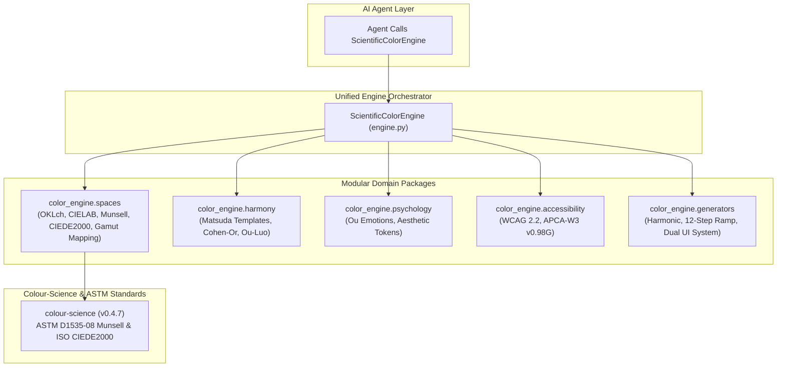

# Color Engine for AI Agents: Modular System Architecture & JSON Specification

> [!NOTE]
> This specification documents the deterministic, modular Color Engine designed for autonomous AI agents. The implementation is located at [`color_engine/`](file:///home/subhradeep/Agentic%20Skill%20Workshop/Color%20Engine/color_engine).

---

## 1. Modular Package Architecture

The engine is organized into clean, single-responsibility submodules powered by OKLch perceptual colorimetry, classical harmony, and `colour-science` for ASTM/ISO standard validation:

```
color_engine/
├── __init__.py           # Unified entrypoint & public API re-exports
├── engine.py             # ScientificColorEngine main class
├── spaces.py             # sRGB <-> Linear <-> LMS <-> OKLab <-> OKLch <-> CIELAB, Munsell, CIEDE2000, Gamut Mapping
├── harmony/
│   ├── __init__.py
│   ├── matsuda.py        # Matsuda 8 templates & Cohen-Or (2006) energy minimization
│   └── ou_luo.py         # Ou-Luo (2006) empirical 2-color harmony & palette mean
├── psychology/
│   ├── __init__.py
│   ├── emotions.py       # Ou et al. (2004) Warm-Cool, Heavy-Light, Active-Passive vectors
│   └── tokens.py         # Deterministic aesthetic token classifier (Kobayashi scale)
├── accessibility/
│   ├── __init__.py
│   ├── wcag.py           # WCAG 2.2 relative luminance & contrast ratio
│   └── apca.py           # APCA-W3 v0.98G lightness contrast (Lc), polarity, typography tiers
└── generators/
    ├── __init__.py
    ├── harmonic.py       # Mono, Analogous, Comp, Split-Comp, Triad, Tetrad, Compound
    ├── ramp.py           # Standardized 12-step monotonic functional tonal ramp
    └── ui_system.py      # Dual-theme (Light/Dark) UI design system with verified contrast
```



---

## 2. API Contracts & JSON Schemas

### 2.1 Palette Analysis Tool (`analyze_palette`)

#### Parameters
```json
{
  "name": "analyze_palette",
  "description": "Calculates scientific color harmony, Matsuda template alignment, Ou-Luo psychophysical comfort, WCAG 2.2 / APCA accessibility contrast, and deterministic aesthetic tokens for a multi-color palette.",
  "parameters": {
    "type": "object",
    "properties": {
      "hex_colors": {
        "type": "array",
        "items": { "type": "string", "pattern": "^#?([A-Fa-f0-9]{6}|[A-Fa-f0-9]{3})$" },
        "minItems": 2,
        "maxItems": 16,
        "description": "List of 2 to 16 hex color codes (e.g. ['#0D0D11', '#D4AF37', '#F5F2EB'])."
      }
    },
    "required": ["hex_colors"]
  }
}
```

#### JSON Output Response Schema
```json
{
  "$schema": "https://json-schema.org/draft/2020-12/schema",
  "title": "ColorEngineAnalysisResult",
  "type": "object",
  "properties": {
    "summary": {
      "type": "object",
      "properties": {
        "palette_size": { "type": "integer" },
        "composite_harmony_score": { "type": "number", "minimum": 0, "maximum": 100 },
        "harmony_grade": { "type": "string", "enum": ["A+", "A", "B", "C", "D"] },
        "primary_aesthetic_token": { "type": "string" },
        "qualifying_tokens": { "type": "array", "items": { "type": "string" } },
        "best_matsuda_scheme": {
          "type": "object",
          "properties": {
            "template": { "type": "string" },
            "optimal_rotation_deg": { "type": "number" },
            "adherence_score": { "type": "number" }
          }
        },
        "ou_luo_empirical_score": { "type": "number" },
        "color_emotion_vector": {
          "type": "object",
          "properties": {
            "warm_cool": { "type": "number" },
            "heavy_light": { "type": "number" },
            "active_passive": { "type": "number" }
          }
        }
      }
    },
    "aesthetic_tokens": {
      "type": "object",
      "additionalProperties": {
        "type": "object",
        "properties": {
          "confidence": { "type": "number", "minimum": 0, "maximum": 1 },
          "qualifies": { "type": "boolean" },
          "justification": { "type": "string" }
        }
      }
    },
    "colors": {
      "type": "array",
      "items": {
        "type": "object",
        "properties": {
          "hex": { "type": "string" },
          "rgb": { "type": "array", "items": { "type": "integer" }, "minItems": 3, "maxItems": 3 },
          "munsell_notation": { "type": ["string", "null"] },
          "oklab": { "type": "object", "properties": { "L": {"type": "number"}, "a": {"type": "number"}, "b": {"type": "number"} } },
          "oklch": { "type": "object", "properties": { "L": {"type": "number"}, "C": {"type": "number"}, "h": {"type": "number"} } },
          "cielab": { "type": "object", "properties": { "L_star": {"type": "number"}, "a_star": {"type": "number"}, "b_star": {"type": "number"}, "C_star": {"type": "number"}, "h_star": {"type": "number"} } },
          "psychological_affect": { "type": "object", "properties": { "warm_cool": {"type": "number"}, "heavy_light": {"type": "number"}, "active_passive": {"type": "number"} } }
        }
      }
    },
    "accessibility_summary": {
      "type": "object",
      "properties": {
        "total_directed_pairs": { "type": "integer" },
        "wcag_aa_passing_pairs": { "type": "integer" },
        "wcag_aa_pass_rate_pct": { "type": "number" }
      }
    },
    "accessibility_matrix": {
      "type": "array",
      "items": {
        "type": "object",
        "properties": {
          "foreground_hex": { "type": "string" },
          "background_hex": { "type": "string" },
          "wcag_contrast_ratio": { "type": "number" },
          "wcag_conformance": {
            "type": "object",
            "properties": {
              "AA_normal_text": { "type": "boolean" },
              "AA_large_text": { "type": "boolean" },
              "AAA_normal_text": { "type": "boolean" },
              "non_text_ui_component": { "type": "boolean" }
            }
          },
          "apca_lightness_contrast_lc": { "type": "number" },
          "apca_polarity": { "type": "string", "enum": ["BoW", "WoB", "Identical"] },
          "apca_tier": { "type": "string" },
          "delta_e_ok": { "type": "number" },
          "delta_e_ciede2000": { "type": "number" }
        }
      }
    },
    "actionable_guidance_for_ai": {
      "type": "array",
      "items": {
        "type": "object",
        "properties": {
          "issue": { "type": "string" },
          "target_color": { "type": "string" },
          "current_hue_deg": { "type": "number" },
          "action": { "type": "string" }
        }
      }
    }
  }
}
```

---

### 2.2 Harmonic Palette Generator Tool (`generate_palette`)

#### Parameters
```json
{
  "name": "generate_palette",
  "description": "Synthesizes a guaranteed harmonious, accessible color palette from a single seed color according to classical and modern color theory.",
  "parameters": {
    "type": "object",
    "properties": {
      "seed_hex": { "type": "string", "description": "Brand seed color (e.g. '#2563EB')" },
      "scheme_type": {
        "type": "string",
        "enum": [
          "monochromatic",
          "analogous",
          "complementary",
          "split_complementary",
          "triadic",
          "tetradic_square",
          "tetradic_rectangle",
          "compound"
        ],
        "default": "monochromatic",
        "description": "Harmonic geometry template to synthesize."
      }
    },
    "required": ["seed_hex"]
  }
}
```

#### JSON Output Return
Returns `{ seed_color, scheme_type, palette_hex, color_roles, analysis }`, where `analysis` contains the complete scientific verification output detailed above.

---

### 2.3 12-Step Functional Tonal Ramp Generator (`generate_tonal_ramp`)

Generates a standard 12-step monotonic progression anchored in OKLch lightness for Radix / Tailwind design system architectures.

```json
[
  {
    "step": 1,
    "hex": "#FAFCFF",
    "target_oklch": { "L": 0.99, "C": 0.01, "h": 264.05 },
    "functional_role": "App Canvas / Background",
    "contrast_vs_step1_canvas": {
      "wcag_ratio": 1.0,
      "passes_wcag_aa_text": false,
      "apca_lc": 0.0,
      "apca_polarity": "Identical",
      "apca_tier": "Fail"
    }
  },
  {
    "step": 11,
    "hex": "#010824",
    "target_oklch": { "L": 0.15, "C": 0.06, "h": 264.05 },
    "functional_role": "Primary Body Copy (APCA Lc >= 90, WCAG >= 7:1)",
    "contrast_vs_step1_canvas": {
      "wcag_ratio": 19.25,
      "passes_wcag_aa_text": true,
      "apca_lc": 103.7,
      "apca_polarity": "BoW",
      "apca_tier": "Body_Preferred_90"
    }
  }
]
```

---

### 2.4 Complete Dual-Theme UI Design System (`generate_ui_design_system`)

Synthesizes both Light Mode and Dark Mode tokens with embedded accessibility verification proofs:

```json
{
  "seed_color": { "hex": "#2563EB", "oklch": { "L": 0.528, "C": 0.215, "h": 264.05 } },
  "light_theme": {
    "surfaces": { "canvas": "#F8FAFF", "surface": "#EAEFF7", "elevated": "#FFFFFF" },
    "borders": { "subtle": "#D5DBE5", "strong": "#8690A2", "focus": "#2563EB" },
    "typography": { "primary": "#050911", "secondary": "#3A4353", "muted": "#717B8D" },
    "actions": { "brand_base": "#2563EB", "brand_hover": "#0B48CF", "on_brand_text": "#FFFFFF" },
    "semantic_status": { "success": "#33862C", "warning": "#BF8100", "error": "#BA2B2E", "info": "#0082C0" },
    "accessibility_verification": {
      "body_text_on_canvas": { "wcag_cr": 19.09, "passes_wcag_aa": true, "passes_wcag_aaa": true, "apca_lc": 102.85, "passes_apca_body": true },
      "secondary_text_on_surface": { "wcag_cr": 8.04, "passes_wcag_aa": true, "apca_lc": 76.4, "passes_apca_content": true },
      "button_text_on_brand": { "wcag_cr": 5.17, "passes_wcag_aa": true }
    }
  },
  "dark_theme": {
    "surfaces": { "canvas": "#04060B", "surface": "#0B0F18", "elevated": "#141B26" },
    "borders": { "subtle": "#222935", "strong": "#535E72", "focus": "#5288F8" },
    "typography": { "primary": "#DFE5EF", "secondary": "#9099A8", "muted": "#5C6472" },
    "actions": { "brand_base": "#5288F8", "brand_hover": "#6C9DFF", "on_brand_text": "#111827" },
    "semantic_status": { "success": "#62AE5A", "warning": "#E1A035", "error": "#E0615C", "info": "#37A8EC" },
    "accessibility_verification": {
      "body_text_on_canvas": { "wcag_cr": 16.01, "passes_wcag_aa": true, "passes_wcag_aaa": true, "apca_lc": -90.66, "passes_apca_body": true },
      "secondary_text_on_surface": { "wcag_cr": 7.35, "passes_wcag_aa": true, "apca_lc": -66.1, "passes_apca_content": true },
      "button_text_on_brand": { "wcag_cr": 5.27, "passes_wcag_aa": true }
    }
  },
  "ergonomic_principles_applied": [
    "Anti-Halation: Dark mode typography capped at L=0.92 to prevent optical irradiation and stroke swelling.",
    "Elevation Tiering: Dark mode communicates depth via monotonic lightness elevation (canvas: 0.12 -> surface: 0.17 -> elevated: 0.22).",
    "Chroma Desaturation: Brand accent is desaturated by ~18% in Dark Mode to eliminate ocular fatigue.",
    "Area Balance: High-chroma brand tokens are reserved for buttons and accents (<10% area), while neutral canvas surfaces dominate (80-90% area).",
    "Spatial Frequency: Contrast thresholds are tied to glyph weight; body text guarantees Lc >= 75 while UI borders target CR >= 3:1."
  ]
}
```

---

## 3. How AI Agents Reason Over the Engine

When an AI agent interacts with this engine, it can:
1. **Directly Request Any Palette Scheme**: Use `engine.generate_palette(seed, scheme_type)` to get immediate production-ready hex codes and complete mathematical analysis.
2. **Build Scalable Web Design Systems**: Use `engine.generate_tonal_ramp(seed)` for CSS component scales or `engine.generate_ui_design_system(seed)` to instantly obtain Light and Dark themes with guaranteed accessibility.
3. **Verify Existing Designs**: Pass any arbitrary set of hex codes into `engine.analyze_palette(colors)` to receive deterministic tokens (`Luxury_HighEnd`, `Modern_Tech`, `Minimalist`, `Playful_Vibrant`, etc.), Munsell notations, ISO CIEDE2000 distances, and targeted harmonic corrections.
