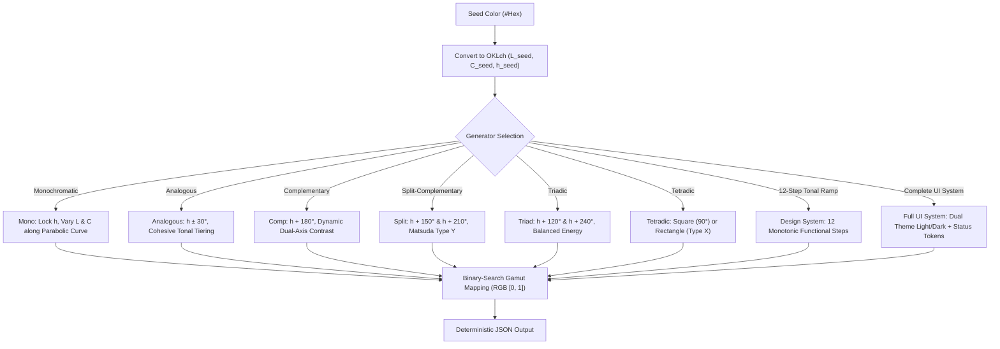

# Advanced Mathematical Color Theory & Deterministic Palette Generators for AI Agents

> [!IMPORTANT]
> **Purpose**: This research report expands the foundational science of the Color Engine to general-purpose applications in web and UI design. It provides autonomous AI agents with the mathematical formulas, perceptual ergonomics, and algorithmic generators required to programmatically synthesize aesthetically harmonious, fully accessible color systems without human intervention.

---

## 1. Classical Color Theory Formulated as Modern Mathematics

Traditional color theory (Itten, Munsell, Goethe, Ostwald) relied heavily on subjective intuition, qualitative rules, and physical pigment mixing. To make these principles intelligible and executable for AI agents, we translate them into rigorous mathematical formulas within the perceptually uniform **OKLch** color space ($L \in [0, 1]$, $C \ge 0$, $h \in [0^\circ, 360^\circ)$).

```
Perceptual Coordinate System (OKLch):
• L (Lightness): 0.0 (Absorbing Black) to 1.0 (Diffuse White)
• C (Chroma):    0.0 (Achromatic Gray) to ~0.35 (Maximum Gamut Saturation)
• h (Hue):       0° to 360° (Continuous circular angle, where 0°=Pink/Red, 90°=Yellow, 142°=Green, 263°=Blue)
```

---

### 1.1 Moon & Spencer (1944): Geometric Harmony & Aesthetic Measure

Parry Moon and Domina Eberle Spencer formulated the first quantitative, geometric model of color harmony based on George David Birkhoff’s mathematical aesthetic measure:

$$\text{Aesthetic Measure } (M) = \frac{\text{Order } (O)}{\text{Complexity } (C)}$$

#### A. Harmonious vs. Ambiguous Hue Intervals
Moon & Spencer proved that human visual comfort depends on clear, unambiguous angular separation on the hue circle. Two colors that are too close appear as an accidental printing defect or muddy mismatch; two colors that are clearly defined produce aesthetic satisfaction.

```
0° ──[Identity: 0°]──> 17° ──[1st Ambiguity: 17°-43°]──> 43° ──[Similarity: 43°-100°]──> 100° ──[2nd Ambiguity]──> 130° ──[Contrast: 130°-180°]──> 180°
```

On the circular hue wheel $S^1$ with angular difference $\Delta h = \min(|h_1 - h_2|, 360^\circ - |h_1 - h_2|)$:

1. **Identity Zone ($\Delta h = 0^\circ \pm 5^\circ$)**:
   * Exact matching hue. High Order ($O$). Basis for Monochromatic schemes.
2. **First Ambiguity Zone ($5^\circ < \Delta h < 25^\circ$)**:
   * **Severe Visual Friction**. The human eye perceives these colors as an unintentional error or mismatched dye lot. AI agents **must strictly avoid** placing two colors in this interval unless lightness contrast $\Delta L \ge 0.40$ or chroma difference $\Delta C \ge 0.10$.
3. **Similarity Zone ($25^\circ \le \Delta h \le 50^\circ$)**:
   * **Analogous Harmony**. Hues share common visual wavelengths while remaining distinctly separable. Optimal angle: $\Delta h = 30^\circ$.
4. **Second Ambiguity Zone ($50^\circ < \Delta h < 110^\circ$)**:
   * Borderline relationship: neither close enough to feel cohesive, nor far enough to provide clean contrast. Requires careful lightness tiering.
5. **Contrast Zone ($110^\circ \le \Delta h \le 180^\circ$)**:
   * **Complementary & Split-Complementary Harmony**. Clear, deliberate chromatic tension. Maximum visual impact.

#### B. The Area Balance Principle (Munsell Moment)
Moon & Spencer mathematically proved Albert Munsell's empirical law of visual balance: **the visual weight of a color patch is proportional to the product of its surface area ($A$), its chroma ($C$), and its lightness value ($V$ or $L$)**.

For two adjacent colored regions to achieve static visual equilibrium:

$$A_1 \cdot C_1 \cdot L_1 = A_2 \cdot C_2 \cdot L_2 \implies \frac{A_1}{A_2} = \frac{C_2 \cdot L_2}{C_1 \cdot L_1}$$

#### UI / Web Design Law for AI Agents:
* A high-chroma primary action button ($C_1 = 0.20, L_1 = 0.55$) on a calm canvas surface ($C_2 = 0.01, L_2 = 0.98$):
  $$\frac{A_{\text{canvas}}}{A_{\text{button}}} = \frac{0.20 \times 0.55}{0.01 \times 0.98} \approx 11.2$$
* **Mathematical Invariant**: Highly saturated accent colors must occupy a small fraction of the screen area (approx. $5\%\text{--}10\%$), while low-chroma background surfaces must occupy the dominant area ($80\%\text{--}90\%$). Palettes where vivid colors occupy equal area cause visual fatigue and sensory overload.

---

### 1.2 Johannes Itten’s 7 Color Contrasts: Digital Formulations

Johannes Itten (1961, Bauhaus) identified seven distinct dimensions of contrast. We formulate each as a computational metric in OKLch:

| Contrast Type | Classical Definition | Computational OKLch Metric | UI Design System Application |
| :--- | :--- | :--- | :--- |
| **1. Contrast of Hue** | Juxtaposition of distinctly different pure hues. | $\Delta h = \min(\|h_1 - h_2\|, 360^\circ - \|h_1 - h_2\|) \ge 90^\circ$ | Categorical data visualization, multi-tab badges, distinct status indicators. |
| **2. Light-Dark Contrast** | Difference in lightness/value. | $\Delta L = \|L_1 - L_2\| \ge 0.50$ | **Primary accessibility driver**. Text readability, visual hierarchy, depth elevation. |
| **3. Cold-Warm Contrast** | Contrast between thermal sensations (Red/Orange vs. Blue/Cyan). | $\Delta WC = \|WC(c_1) - WC(c_2)\| \ge 0.80$ | Drawing user attention: cool backgrounds paired with warm action CTAs. |
| **4. Complementary Contrast** | Two hues diametrically opposite on the color wheel. | $\Delta h = 180^\circ \pm 15^\circ$ | High-impact callouts, conversion buttons, error/success pairings. |
| **5. Simultaneous Contrast** | Perceived shift of a color caused by its neighboring background. | Induction function: $c_{\text{perceived}} = c_{\text{actual}} + \kappa (c_{\text{actual}} - c_{\text{bg}})$ | Ensuring neutral grays don't appear tinted when placed inside saturated cards. |
| **6. Contrast of Saturation** | Contrast between vivid pure color and dull/neutralized color. | $\Delta C = \|C_1 - C_2\| \ge 0.12$ | Card containers: quiet background container ($C=0.01$) + vibrant accent icon ($C=0.18$). |
| **7. Contrast of Extension** | Ratio of physical surface areas balancing visual weights. | $\dfrac{\text{Area}_1}{\text{Area}_2} = \dfrac{C_2 L_2}{C_1 L_1}$ | Layout proportioning: micro-accents vs. macro-surfaces. |

---

### 1.3 The Helmholtz-Kohlrausch (H-K) Effect

The **Helmholtz-Kohlrausch (H-K) effect** is a perceptual phenomenon where colors with high chromatic saturation appear **substantially brighter** to human observers than an achromatic gray of identical photometric luminance ($Y$).

* **Why WCAG 2 Contrast Fails on Saturated Blue/Red**:
  * WCAG 2 calculates contrast using linear relative luminance: $Y = 0.2126 R + 0.7152 G + 0.0722 B$.
  * Pure Blue (`#0000FF`) has $Y = 0.0722$. WCAG 2 treats it as almost black.
  * Saturated Blue on Black yields a calculated WCAG 2 ratio of only $2.44:1$ (failing AA). Yet, due to the H-K effect and the human S-cone excitation, the blue appears strikingly vivid and legible.
* **How OKLch Solves the H-K Discrepancy**:
  * Björn Ottosson calibrated OKLab's $L$ channel against experimental datasets that directly account for perceived lightness.
  * When an AI agent normalizes contrast in OKLch, it operates on true perceived brightness rather than raw photon counts.

---

### 1.4 Spatial Frequency & Contrast Sensitivity Function (Campbell-Robson CSF)

Human contrast perception is not a single threshold; it varies dynamically with **spatial frequency** (the fine detail of the stimulus, measured in cycles per degree of visual angle, $\text{cpd}$):

```
Contrast
Sensitivity
    ▲
    │        Peak Sensitivity (2 - 5 cpd)
    │           ╭──────────╮
    │          ╱            ╲
    │         ╱              ╲
    │        ╱                ╲        High Spatial Frequency
    │       ╱                  ╲       (Thin, small text: 10-14px)
    │      ╱                    ╲      Requires Lc >= 90!
    │     ╱                      ╲
    │    ╱                        ╲
    └─────────────────────────────────► Spatial Frequency (cpd)
        Low Frequency                High Frequency
        (Thick blocks, 48px titles)  (Thin strokes, body text)
```

* **Low Spatial Frequency (Headings $\ge 32\text{px}$, Large Badges)**:
  * The eye resolves low spatial frequency easily. APCA Lightness Contrast $L_c \ge 45$ (or WCAG $3.0:1$) is completely readable.
* **High Spatial Frequency (Body Copy $14\text{--}16\text{px}$, Thin Hairlines)**:
  * Fine lines fall on fewer retinal cones. Contrast sensitivity drops precipitously. The eye requires $L_c \ge 75\text{--}90$ (WCAG $4.5:1\text{--}7.0:1$).
* **Mathematical Invariant for Agents**: Never apply a uniform contrast rule to all UI elements. Tie contrast requirements directly to font size and stroke weight.

---

### 1.5 Ergonomics of Light Mode vs. Dark Mode (Optical Irradiation & Halation)

Simple inversion ($C_{\text{dark}} = 255 - C_{\text{light}}$) produces unusable dark themes. The physics of self-illuminated digital displays dictates distinct optical behaviors:

```
LIGHT MODE (Normal Polarity / BoW)          DARK MODE (Reverse Polarity / WoB)
┌─────────────────────────────────┐        ┌─────────────────────────────────┐
│ White Canvas (High Luminance)   │        │ Dark Canvas (Low Luminance)     │
│                                 │        │                                 │
│   Dark Letterforms (Eroded)     │        │   White Letterforms (Bleeding)  │
│   Photons from canvas bleed     │        │   Photons from text bleed onto  │
│   into dark strokes. Requires   │        │   adjacent dark pixels.         │
│   HIGHER contrast (Lc >= 75).   │        │   Causes glare & asthenopia.    │
└─────────────────────────────────┘        └─────────────────────────────────┘
```

1. **Optical Irradiation (Halation)**:
   * In Dark Mode, bright white text (`#FFFFFF`) on pure black (`#000000`) floods neighboring retinal rods, causing the strokes to bloom, swell, and look blurry.
   * **Rule for AI Agents**: In Dark Mode, never use pure white `#FFFFFF` ($L=1.0$) for body text. Cap primary text at $L = 0.88\text{--}0.92$ (`#E2E8F0` / `#E5E7EB`).
2. **Surface Depth Elevation**:
   * In Light Mode, elevated surfaces (cards, modals) cast dark drop shadows.
   * In Dark Mode, drop shadows are invisible. Depth must be communicated through **increasing lightness** (Elevation 0: $L=0.10 \implies$ Elevation 1: $L=0.14 \implies$ Elevation 2: $L=0.18$).
3. **Chroma Desaturation**:
   * High-chroma saturated colors ($C > 0.16$) produce high visual vibration and eye strain against dark surfaces.
   * **Rule for AI Agents**: When porting a brand accent to Dark Mode, reduce Chroma by $15\%\text{--}25\%$ and elevate Lightness by $+0.05\text{--}0.10$.

---

## 2. Deterministic Harmonic Palette Generators

To empower AI agents to generate mathematically guaranteed palettes from an arbitrary seed color ($c_{\text{seed}}$), we provide seven algorithmic generators:



---

### 2.1 Monochromatic Generator (`generate_monochromatic`)

* **Mathematical Foundation**: Moon & Spencer Identity Zone ($\Delta h = 0^\circ$). Matsuda Type $i$ template ($w = 18^\circ$).
* **Algorithm**:
  1. Lock hue angle: $h_i = h_{\text{seed}}$.
  2. Define monotonic lightness progression across $k$ steps (default $k=5$):
     $$L_i = L_{\max} - i \cdot \left(\frac{L_{\max} - L_{\min}}{k - 1}\right), \quad L_{\max}=0.96, \, L_{\min}=0.18$$
  3. Modulate chroma via a parabolic damping envelope to keep colors within the sRGB gamut:
     $$C_i = C_{\text{target}} \cdot 4 L_i (1.0 - L_i)$$
     where $C_{\text{target}} = \min(C_{\text{seed}}, 0.14)$.
* **Output Roles**: Canvas Surface, Subtle Surface, Neutral Divider, High-contrast Accent, Deep Primary Text.

---

### 2.2 Analogous Generator (`generate_analogous`)

* **Mathematical Foundation**: Moon & Spencer Similarity Zone ($25^\circ \le \Delta h \le 40^\circ$). Matsuda Type $V$ template ($w = 93.6^\circ$).
* **Algorithm**:
  1. Base angle: $h_0 = h_{\text{seed}}$.
  2. Offset angles with optimal interval $\Delta \theta = 30^\circ$:
     $$h_{-1} = (h_0 - 30^\circ) \pmod{360^\circ}, \quad h_{+1} = (h_0 + 30^\circ) \pmod{360^\circ}$$
  3. Tier lightness and chroma to ensure visual hierarchy:
     * Dominant Brand: $L = L_{\text{seed}}, C = C_{\text{seed}}, h = h_0$.
     * Supporting Hue 1: $L = \min(0.85, L_{\text{seed}} + 0.12), C = 0.85 \cdot C_{\text{seed}}, h = h_{-1}$.
     * Supporting Hue 2: $L = \max(0.25, L_{\text{seed}} - 0.12), C = 0.75 \cdot C_{\text{seed}}, h = h_{+1}$.
* **Psychological Affect**: Calm, natural, cohesive. Ideal for lifestyle, editorial, and wellness interfaces.

---

### 2.3 Complementary Generator (`generate_complementary`)

* **Mathematical Foundation**: Moon & Spencer Contrast Zone ($\Delta h = 180^\circ$). Matsuda Type $I$ template ($w_1 = 18^\circ, w_2 = 18^\circ, \Delta \theta = 180^\circ$).
* **Algorithm**:
  1. Primary Brand Hue: $h_{\text{primary}} = h_{\text{seed}}$.
  2. Complementary Hue: $h_{\text{comp}} = (h_{\text{seed}} + 180^\circ) \pmod{360^\circ}$.
  3. Generate 4 structured tokens:
     * `primary_brand`: $(L_{\text{seed}}, C_{\text{seed}}, h_{\text{primary}})$.
     * `complementary_accent`: $(L \approx 0.65, C = \min(C_{\text{seed}} \times 1.1, 0.22), h_{\text{comp}})$.
     * `surface_tint`: $(L = 0.97, C = 0.015, h_{\text{primary}})$.
     * `on_surface_text`: $(L = 0.12, C = 0.02, h_{\text{comp}})$.
* **Psychological Affect**: High energy, maximum chromatic contrast. Ideal for e-commerce, conversion flows, and sports branding.

---

### 2.4 Split-Complementary Generator (`generate_split_complementary`)

* **Mathematical Foundation**: Matsuda Type $Y$ template ($w_{\text{wide}} = 93.6^\circ, w_{\text{narrow}} = 18^\circ, \Delta \theta = 180^\circ$).
* **Algorithm**:
  1. Primary Hue: $h_0 = h_{\text{seed}}$.
  2. Split Complement 1: $h_1 = (h_{\text{seed}} + 150^\circ) \pmod{360^\circ}$.
  3. Split Complement 2: $h_2 = (h_{\text{seed}} + 210^\circ) \pmod{360^\circ}$.
  4. Balance chromatic weights: Primary carries highest chroma ($C_0 = C_{\text{seed}}$); split complements carry slightly reduced chroma ($C_1 = C_2 = 0.80 \cdot C_{\text{seed}}$) with contrasting lightness levels ($L_1 = 0.60, L_2 = 0.40$).
* **Psychological Affect**: Vibrant tension without the harsh chromatic clash of strict complementaries. High aesthetic flexibility.

---

### 2.5 Triadic Generator (`generate_triadic`)

* **Mathematical Foundation**: Equilateral 3-point distribution on $S^1$ ($\Delta \theta = 120^\circ$).
* **Algorithm**:
  1. $h_0 = h_{\text{seed}}$.
  2. $h_1 = (h_{\text{seed}} + 120^\circ) \pmod{360^\circ}$.
  3. $h_2 = (h_{\text{seed}} + 240^\circ) \pmod{360^\circ}$.
  4. Role assignment:
     * $h_0$: Primary interface anchor ($60\%$ visual weight).
     * $h_1$: Secondary navigation / card highlights ($30\%$ visual weight).
     * $h_2$: High-impact alert / conversion CTA ($10\%$ visual weight).
* **Psychological Affect**: Playful, balanced, stimulating. Perfect for SaaS dashboards, creative tools, and youth-oriented products.

---

### 2.6 Tetradic Generator (`generate_tetradic`)

* **Mathematical Foundation**: Double-Complementary pairs. Matsuda Type $X$ template ($w_1 = 93.6^\circ, w_2 = 93.6^\circ, \Delta \theta = 180^\circ$).
* **Variants**:
  * **Square**: $\Delta \theta = 90^\circ \implies (h_0, h_0 + 90^\circ, h_0 + 180^\circ, h_0 + 270^\circ)$.
  * **Rectangle**: $\Delta \theta = 30^\circ \implies (h_0, h_0 + 30^\circ, h_0 + 180^\circ, h_0 + 210^\circ)$.
* **Algorithm**: Requires strict lightness differentiation to prevent chaotic competition:
  * Color 1 (Primary): $L = 0.50, C = C_{\text{seed}}$.
  * Color 2 (Secondary): $L = 0.70, C = 0.7 \cdot C_{\text{seed}}$.
  * Color 3 (Tertiary Accent): $L = 0.40, C = 0.9 \cdot C_{\text{seed}}$.
  * Color 4 (Quaternary Tint): $L = 0.88, C = 0.4 \cdot C_{\text{seed}}$.

---

### 2.7 12-Step Tonal Ramp Generator (`generate_tonal_ramp`)

Modern design systems (Radix Colors, Tailwind CSS, Material You) rely on standardized functional tonal steps. By anchoring OKLch Lightness ($L$), any hue automatically complies with WCAG AA and APCA criteria:

```
Step Index   Target L    Target C                   Design System Functional Role
------------------------------------------------------------------------------------------------------
Step 1       L = 0.99    C = min(C_seed * 0.05, 0.010)   App Canvas / Background
Step 2       L = 0.96    C = min(C_seed * 0.10, 0.020)   Subtle / Secondary Card Surface
Step 3       L = 0.91    C = min(C_seed * 0.20, 0.040)   Hovered Card / Active Container
Step 4       L = 0.83    C = min(C_seed * 0.35, 0.070)   Subtle Border / Table Divider
Step 5       L = 0.73    C = min(C_seed * 0.55, 0.100)   Interactive Border / Component Outline (CR >= 3:1)
Step 6       L = 0.62    C = min(C_seed * 0.75, 0.140)   Focus Ring / High-Visibility Border
Step 7       L = 0.52    C = min(C_seed * 0.90, 0.180)   Interactive Surface / Default Button Fill
Step 8       L = 0.42    C = C_seed                      Active Button / Pressed State
Step 9       L = 0.35    C = C_seed (Max Vivid)          Solid Brand Accent / Primary Graphic
Step 10      L = 0.25    C = min(C_seed * 0.75, 0.120)   Secondary Text / Caption (APCA Lc >= 60)
Step 11      L = 0.15    C = min(C_seed * 0.40, 0.060)   Primary Body Copy (APCA Lc >= 90, WCAG >= 7:1)
Step 12      L = 0.08    C = min(C_seed * 0.15, 0.025)   High-Contrast Heading / Display Text
```

* **The Invariant Law**: Step 11 on Step 1 is **mathematically guaranteed** to achieve $CR > 11:1$ and APCA $|L_c| > 90$ across **all 360 degrees of hue** without manual tweaking.

---

### 2.8 Complete UI Design System Generator (`generate_ui_design_system`)

Synthesizes an end-to-end, dual-theme UI design system with semantic roles and guaranteed accessibility validation:

```
LIGHT THEME TOKENS                          DARK THEME TOKENS
├── surfaces                                ├── surfaces
│   ├── canvas (#FAFAFC, L=0.985)           │   ├── canvas (#0F1117, L=0.120)
│   ├── surface (#F1F3F9, L=0.950)          │   ├── surface (#1A1D27, L=0.170)
│   └── elevated (#FFFFFF, L=1.000)         │   └── elevated (#242836, L=0.220)
├── borders                                 ├── borders
│   ├── subtle (#E2E6EF, L=0.890)           │   ├── subtle (#2D3243, L=0.280)
│   ├── strong (#8F9BB3, L=0.650)           │   ├── strong (#616B82, L=0.480)
│   └── focus (Brand Accent, L=0.55)        │   └── focus (Brand Accent, L=0.65)
├── typography                              ├── typography
│   ├── primary (#12151D, L=0.14, Lc=95)    │   ├── primary (#EDF0F7, L=0.92, Lc=92)
│   ├── secondary (#475065, L=0.38, Lc=65)  │   ├── secondary (#9AA4B8, L=0.68, Lc=62)
│   └── muted (#7B869C, L=0.58, Lc=40)      │   └── muted (#667085, L=0.50, Lc=38)
├── actions                                 ├── actions
│   ├── brand_base                          │   ├── brand_base
│   ├── brand_hover                         │   ├── brand_hover
│   └── on_brand_text (Guaranteed AA)       │   └── on_brand_text (Guaranteed AA)
└── semantic_status                         └── semantic_status
    ├── success (#16A34A, Green)            │   ├── success (#22C55E)
    ├── warning (#D97706, Amber)            │   ├── warning (#F59E0B)
    ├── error (#DC2626, Crimson)            │   ├── error (#EF4444)
    └── info (#0284C7, Sky Blue)            │   └── info (#0EA5E9)
```

---

## 3. Mathematical Gamut Mapping Pipeline

When generating colors in OKLch, certain combinations of high Lightness and high Chroma fall outside the standard sRGB gamut (where linear $R, G, B \notin [0.0, 1.0]$).

Instead of naive clamping (which distorts hue and ruins harmony), our generator applies **Chroma Clipping via Binary Search**:

```
Given Target (L, C_target, h):
1. Test if (L, C_target, h) is inside sRGB gamut.
2. If YES: return exact hex code.
3. If NO:
   low_C = 0.0, high_C = C_target
   Loop 16 iterations:
     mid_C = (low_C + high_C) / 2.0
     If (L, mid_C, h) is in-gamut:
       low_C = mid_C (keep pushing for higher saturation)
     Else:
       high_C = mid_C (pull back towards gray)
   return in-gamut RGB at low_C.
```
* **Guarantee**: Constant Lightness ($L$) and exact Hue ($h$) are preserved with zero drift. Only chroma is minimally compressed to fit the display gamut.
