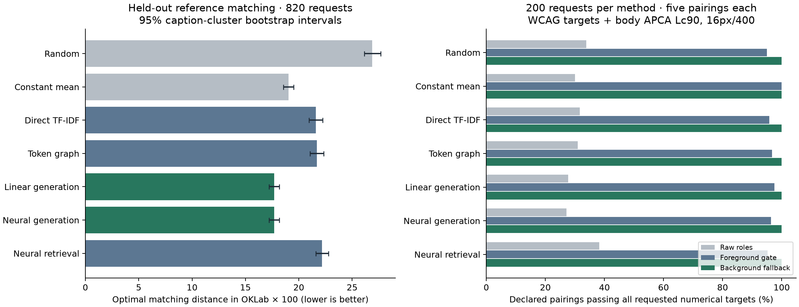
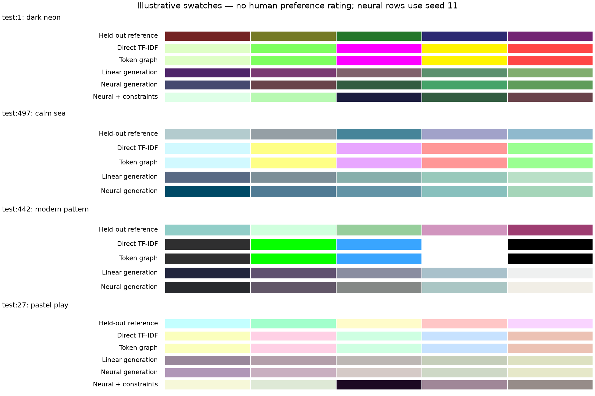

# Token-conditioned palette generation: research and controlled comparison

Research date: 2026-11-03. Engine baseline: `b21aa904896cb897ec5ad8e16b7b8debbcc93be5`.

## Finding

The hypothesis is feasible as a research prototype: weighted tokens can produce candidate palettes, and a separate constraint stage can return verified role colors. These experiments do not justify assuming that a token graph or neural network is better than a simple model, or that an internal similarity score represents human aesthetic agreement.

The tested neural generator and linear generator were essentially tied on held-out reference-color matching: **17.688 versus 17.707** in our distance measure. Their paired difference was **−0.019**, with a 95% interval of **−0.164 to +0.138**. The token graph did not clearly improve over direct token retrieval either. A more complex architecture therefore has no demonstrated advantage in this experiment.

The exploratory constraint fallback passed **7,000 of 7,000 declared pairing checks** on **1,400 requests**, when additional background changes were allowed. Color changes and reference-matching degradation are recorded rather than hidden. This validates those numerical checks, not the aesthetic quality of the resulting interfaces or whole-page WCAG conformance.



## Research performed before model planning

Downloaded nine PDFs and reviewed their relevant methods, evaluations, limitations, and selected architecture figures. Read technical posts from Stripe and the Oklab author, Adobe Leonardo documentation, W3C text/non-text contrast guidance, and APCA typography guidance. The IBM graph paper's institutional abstract was readable; its full IEEE text was inaccessible. We did not infer results from an unread full paper.

The [literature review](./LITERATURE.md) records source-specific findings and limits, with links to the primary publications. The [source index](./sources-index.json) and acquisition manifests preserve URLs and file hashes. Downloaded PDFs and text extracts remain locally under `sources/pdfs` and `sources/text`.

The sources establish several relevant precedents: text-conditioned palette generation, semantic graph propagation, palette-level preference learning, and combining learned objectives with explicit constraints. They do not establish a universal style ontology or a calibrated similarity percentage for arbitrary mixtures of concepts. See [Text2Colors](https://arxiv.org/abs/1804.04128), the [IBM institutional summary](https://research.ibm.com/publications/cognitive-color-palette-creation-using-client-message-and-color-psychology), and [Accessible Color Sequences](https://arxiv.org/abs/2107.02270).

We wrote the [fixed protocol](./PROTOCOL.md) after reviewing the sources and inspecting dataset format/coverage, before fitting experimental models. Later constraint and score diagnostics are explicitly [exploratory](./EXPLORATORY_FOLLOWUP.md).

## Data and leakage controls

Used RGB/text CSVs from the [official 2023 paper implementation](https://github.com/CyberAgentAILab/text2palette), pinned to revision `45948e2f3baddb9bab61921b5d5fbc9b0a8b6809`. The data derive from the human-curated Palette-and-Text collection; they are caption/palette associations, not ratings of weighted aesthetic blends.

The published files contain 8,147 training, 1,018 validation, and 1,018 test rows. Our audit found 187 test descriptions and three test palettes represented in training. After deduplicating palettes and removing held-out descriptions/palettes appearing in retained earlier splits, the experiment uses:

| Split | Retained rows |
| :--- | ---: |
| Train | 8,131 |
| Validation | 795 |
| Test | 820 |

The initial audit reported 794 clean validation rows before training deduplication. Removing duplicate training palettes also removes some aliases, yielding 795 validation rows under the finalized retained-row rule. [Every retained ID](./experiment-01/split_manifest.json) is saved.

Vocabulary, IDF weights, SVD, co-occurrence graph, scalers, and regressors were fitted on training only. Hyperparameters and the preferred method were selected on validation and [frozen before test scoring](./experiment-01/selection_frozen_before_test.json). Neural methods use three predeclared initialization seeds. No test results were used to select the reported model configuration.

Only **594/820** test descriptions contain a surviving vocabulary term. A further [posthoc representation audit](./representation_novelty.json) finds 272 of those map to a unigram/IDF vector already present in training, despite having different full captions; 322 have novel representations. We therefore do not describe all held-out rows as unseen token combinations. Reference palettes remain disjoint, and the primary results are unchanged. Coverage is explicit, including for requests with no supported terms. Across the complete source dataset, cyberpunk and maximalism each have zero examples; neon has 53, calm 25, bold 12, and modern 35. Minimalism has one example. The learned representation has 1,606 tokens and 8,286 graph edges. It does not establish coverage of the desired aesthetic ontology.

## Controlled results

The primary measure is the mean optimal one-to-one matching distance between predicted and held-out reference colors, using Euclidean OKLab distance multiplied by 100. Hungarian assignment removes dependence on arbitrary swatch storage order. Lower is better. This is a reference-fidelity proxy, not a beauty score, and its units differ from published DCCW experiments.

| Method | Mean distance ↓ | 95% interval |
| :--- | ---: | :--- |
| Random training palette | 26.888 | 26.137–27.679 |
| Constant mean palette | 19.046 | 18.566–19.531 |
| Direct TF-IDF retrieval | 21.609 | 20.971–22.251 |
| Token-graph propagation | 21.706 | 21.040–22.321 |
| Linear generation | 17.707 | 17.215–18.177 |
| Neural generation | 17.688 | 17.214–18.158 |
| Neural palette retrieval | 22.182 | 21.590–22.798 |

Intervals use 2,000 bootstrap draws clustered by normalized test description. Neural errors are averaged across the three seeds before uncertainty calculations. These intervals characterize this dataset; they do not cover uncertainty across different cultures, datasets, architectures, or annotation practices.

The validation-selected model was a (128,64)-unit MLP generator. The linear comparator selected ridge alpha 1, and the graph selected diffusion strength 0.6. These are lightweight baselines inspired by the papers, not reproductions of their GANs, attention models, or IBM's full graph.

Important paired comparisons:

- **Neural minus linear:** −0.019, interval [−0.164, +0.138]. No clear neural gain.
- **Graph minus direct retrieval:** +0.098, interval [−0.257, +0.454]. No clear graph gain.
- **Neural minus constant mean:** −1.358, interval [−1.705, −1.019]. Conditioning adds useful information under this proxy.
- **Neural retrieval minus direct retrieval:** +0.573, interval [−0.151, +1.281]. No demonstrated improvement.

The shuffled-request control increases neural-generation error from **17.688 to 20.670**. Its paired gain from correct requests is **2.982**, interval [2.451, 3.534]. This supports a real association between represented words and reference colors, rather than a model merely returning the same useful prior for every request.

These are not independent human judgments of the outputs. A model can improve reference distance by predicting conditional averages, and each caption can plausibly match multiple palettes. See [all semantic results](./experiment-01/semantic_results.json), [paired differences](./experiment-01/paired_differences.json), and [per-query errors](./experiment-01/per_query.json).

### Exploratory aesthetic-word subset

To investigate reliance on literal color words, a posthoc diagnostic selected descriptions containing one of the initially audited aesthetic terms while excluding basic color names. Only **32** test requests qualify. Neural and linear means are **15.999 and 16.617**, but the paired difference interval is **[−1.816, +0.425]**. This small, exploratory subset does not establish a neural advantage or validate cyberpunk/maximalism blending. [Definition and results](./subset_diagnostics.json); [paired interval](./aesthetic_subset_paired_difference.json).

## Similarity scores: what the evidence permits

The primary retrieval-score diagnostic measures association with independent held-out reference error:

| Internal score | Spearman correlation with error |
| :--- | ---: |
| Direct token/caption cosine | −0.103 |
| Diffused token/caption cosine | −0.120 |
| Neural retrieval cosine | +0.003 |

A useful score would tend to correlate negatively with reference error. The first two associations are weak, and the tested neural retrieval score is essentially uninformative by this measure. None is a calibrated probability of human aesthetic agreement.

The prototype also computes a different, common palette-to-text cosine for generated outputs. This was examined posthoc: neural-generation first-seed scores correlate **−0.212** with raw reference error on represented requests, and **−0.180** after constraints on the represented accessibility sample. This modest association is not sufficient to reinterpret cosine as a percentage match or confidence. [Prototype-score diagnostics](./prototype_score_diagnostics.json) and [row measurements](./prototype_score_rows.json) distinguish these scores from the primary retrieval scores.

The interface consequently returns `aesthetic_confidence: null`, discloses score provenance and calibration limits, and labels the cosine as experimental. Calling a generated palette “92% cyberpunk” would not be justified by these results.

## Accessibility and the cost of constraints

All methods receive the same 200 held-out requests and alternating light/dark settings. Roles are assigned without inspecting the target palette. The five numerical checks are body text on canvas and surface, brand and accent graphics on canvas, and button text on brand. The body requirement is WCAG 4.5:1 plus conservative APCA Lc90 guidance for 16px/400; graphics use 3:1 and button text 4.5:1.

These targets follow the declared use cases, rather than interpreting every possible color pairing as a required text pair. Text and meaningful non-text requirements are distinct. [W3C text guidance](https://www.w3.org/WAI/WCAG22/Understanding/contrast-minimum.html), [non-text guidance](https://www.w3.org/WAI/WCAG22/Understanding/non-text-contrast.html), and [APCA typography guidance](https://github.com/Myndex/SAPC-APCA/blob/master/documentation/APCA_in_a_Nutshell.md) support the distinction. APCA is reported separately from WCAG 2.2.

| Method | Raw combined passes | Foreground gate | Background fallback | Additional background changes |
| :--- | ---: | ---: | ---: | ---: |
| Random | 339/1000 | 950/1000 | 1000/1000 | 28/200 |
| Constant mean | 300/1000 | 1000/1000 | 1000/1000 | 0/200 |
| Direct retrieval | 317/1000 | 958/1000 | 1000/1000 | 27/200 |
| Token graph | 310/1000 | 967/1000 | 1000/1000 | 23/200 |
| Linear generation | 277/1000 | 976/1000 | 1000/1000 | 15/200 |
| Neural generation | 272/1000 | 964/1000 | 1000/1000 | 21/200 |
| Neural retrieval | 382/1000 | 952/1000 | 1000/1000 | 31/200 |

The fixed foreground-only stage produces **6,939/7,000 WCAG passes** and **6,767/7,000 combined WCAG/APCA-target passes**. Infeasible results remain marked as failures. The exploratory fallback moves neutral backgrounds toward the theme endpoint when explicitly permitted, then recalculates every foreground check. It achieves all 7,000 combined passes in this sample.

This is not free. On the neural method's same 200 cases, raw reference error is **17.776**, rising to **22.508** after the fallback. Mean movement of assigned role colors is **13.727 OKLab ×100**. That change is not a percentage of lost aesthetic quality; it is a measured color displacement. It shows why satisfying role constraints and preserving a reference palette must be evaluated separately. The additional APCA Lc90 target is stronger than a WCAG-only test. Role assignment and theme clamping also change colors, so these costs must not be attributed to WCAG alone. Themes were assigned independently of caption words; some requests intentionally conflict with words such as “dark.” Projected reference distance measures this complete role/theme/contrast adaptation, not an isolated accessibility effect.

The [measurement audit](./measurement_audit.json) independently recomputes all **21,000** raw/foreground/fallback pairing records using a standalone WCAG calculation and APCA remeasurement. [Compact audit CSV](./contrast_measurements.csv.gz), [retained failures](./constraint_failures.json), [original-stage cases](./experiment-01/accessibility_cases.json.gz), and [fallback cases](./exploratory-background-01/cases.json.gz) preserve the evidence. Uncompressed originals also remain locally.



Constrained rows use the fixed sample theme, which is not inferred from the caption. These swatches also illustrate why a low average reference error cannot establish aesthetic quality: regression can produce muted conditional averages even for words such as neon. No human preference ranking is inferred from this illustration.

## Experimental agent interface

The research prototype accepts a weighted token map and returns candidates containing raw colors, named roles, exact usage audits, numerical targets, proposed changes, provenance, and explicitly uncalibrated similarity values. It rejects unsupported concepts by default and only marks candidates approved when every declared check passes.

The [neon/calm example](./example-neon-calm.json) returns three verified candidates for `{"neon": 0.6, "calm": 0.4}`. The [cyberpunk example](./example-unsupported.json) returns `unsupported_tokens`, identifies the missing concept, and generates no substitute palette. Weighted input is implemented, but human judgments of those numerical blend strengths were not available for training or evaluation.

Run the locally generated bundle:

```bash
python3 -m research.token_conditioning.prototype \
  --bundle review_runs/20261103-token-conditioning/experiment-01/models/research_bundle.joblib \
  --targets '{"neon":0.6,"calm":0.4}' \
  --theme dark --allow-background-changes \
  --output review_runs/a-new-token-example.json
```

The prototype is separate from the installed `color_engine` tools. Existing weights, schemas, and default runtime behavior are preserved. Its three neural candidates arise from different training initializations; they are not a learned distribution of all plausible palettes. It supports the fixed experimental five-role and typography contract, not every arbitrary layout or font request.

## Evidence-backed implementation direction

1. **Keep deterministic constraint checks and explicit infeasibility.** Treat model output as a candidate. Verify the actual hex values after each repair and expose allowed background changes.
2. **Retain linear generation and retrieval as strong baselines.** The current test does not justify replacing them with a graph or larger neural network. A graph remains a research option, particularly with richer relation types or pretrained semantics, which were not tested here.
3. **Build the missing palette-level concept dataset.** Annotate aesthetic affinities for complete palettes, with roles and area proportions where those matter. Include cyberpunk, maximalism, and other requested concepts, multiple raters, and explicit disagreement. Palette affinity should be distinguished from full-layout minimalism/maximalism.
4. **Define what a similarity score predicts.** Cosine can remain a transparent internal ranking signal. A human-agreement probability requires a defined rating event, independent held-out annotations, and calibration tests. Do not validate a model using its own heuristic labels or scores.
5. **Test blended and unseen concepts explicitly.** Hold out complete combinations, evaluate alternative feasible outputs, and measure semantic change after constraints. A model that performs well on single words has not automatically learned weighted style composition.
6. **Promote only after independent validation.** Compare the proposed learned system with the current engine and simple baselines on matched tasks, request contexts, and human-reviewed outcomes. These experiments do not prove that a generic graph-neural architecture is ineffective; they establish the limits of the tested small models and data.

## Reproduction and preserved artifacts

[Reproduction instructions](./REPRODUCE.md) include data acquisition, fixed experiment, exploratory stages, prototype, and tests. [Protocol](./PROTOCOL.md), [validation log](./experiment-01/validation.json), [frozen selection](./experiment-01/selection_frozen_before_test.json), [environment](./experiment-01/environment.json), [source snapshots](./experiment-01/source_snapshot/), and [final manifest](./MANIFEST-FINAL.json) identify the run.

Verification passes all **43 unit tests on Python 3.14.8 and Python 3.11.16**, plus the original engine verification script. [Python 3.14 log](./logs/full-suite-python314.log), [Python 3.11 log](./logs/full-suite-python311-02.log), and [original-engine log](./logs/original-engine-verification.log) are retained.

The [evidence verification](./evidence-verification.json) checks disjoint splits and source/data hashes, then exactly replays **9,020 saved palette outputs** without fitting or selecting models again. Compressed evidence is verified lossless. Existing production runtime, weights, and historical reports are unchanged.

Logs include acquisition failures, intermediate checks, fitting diagnostics, and final verification. The first Python 3.11 test launch referenced a temporary interpreter from the prior session that was no longer present; environment recreation attempts are retained alongside the final result. No log or historical artifact was deleted.

Raw papers, extracted text, datasets, and locally fitted model bundles remain in the research folder but are excluded from versioned runtime artifacts. Compressed case evidence, summaries, plots, source metadata, and code are versioned. No existing production model or dataset was overwritten, and no external human-study response was fabricated.
